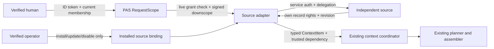

# Architecture and trust boundaries

**DRAFT / NOT DEPLOYED.** This page describes a proposed integration. Shipped behavior and release status are in [current state](../current-state.md). No topology here authorizes real app data, provider calls, production credentials, or deployment.

## Ownership and principals

| Principal | Identity source | Owns or may authorize | Boundary |
| --- | --- | --- | --- |
| Human owner/actor | Verified end-user identity and current membership; maps to PAS `RequestScope` | Their own request and explicit, scoped grants | IDs in a body never establish identity or consent |
| Operator | Verified control-plane role | Install, update and disable an app source binding | Cannot perform owner reads or create owner grants |
| External app client | Operator installation bound to one PAS app | Its own client identity | Cannot authenticate an end user by service credential |
| Independent source service | Installation-bound service identity and pinned origin | Its own authoritative records and source-side membership checks | Does not rely on a PAS signature as a substitute for its own record rights |
| PAS signer/verifier | PAS-managed signing keys | Narrow, short-lived delegation for one authorized operation | Signature is not a live grant or a revocation lease |
| Recipient/host | Separate destination identity, grant and, when relevant, verified host | The exact disclosed projection or dispatch | Runtime, ChatGPT, manual, and other recipients are distinct |

The human-to-PAS consumer authentication, PAS-to-source service authentication, and ChatGPT-to-PAS protected MCP authentication are separate trust relationships. A source delegation binds the verified human subject and actor, owner, app, workspace, source installation and epoch, kind/field allowlist, purpose, recipient, operation, request digest/nonce, grant and epoch, issuer, audience, issue/expiry, and key ID. Both PAS and the source check their own authority; source membership and record ownership are still required.



## Shared context path

The adapter is a provider of typed, bounded projections. It uses the existing `ContextItem`, application field policy, context provider coordinator, planner, and assembler. It does not add a second memory, permission engine, token counter, routing service, or model call. For the synthetic owner-domain facts, the source class is `domain_current` and authority may be `authoritative` only for the original owning application. Source text is data, not instructions. Existing same-app rules and server-owned sensitivity classification apply; no cross-app promotion is proposed.

`ContextItem` mapping is specified field by field in the [application context contract](application-context-contract.md). In particular, every item has a typed payload, non-empty exact source reference, pinned source identity/revision, verified scope, field sensitivity, and a dependency created from PAS live-grant authority. Source echoed grants are never sufficient. Search maps to the existing `search` operation; `fetch` is internal adapter retrieval detail. The planner retains its existing result, byte, token and deadline limits and required-history behavior.

## Installation, source reads and export

Operator installation is a control plane with an operator principal. It binds app, pinned origin, service identity, schema and policy, but receives no user workspace and grants no record access. Owner reads are a separate human-scoped plane with a signed request delegation. Stage 1 uses only an in-memory synthetic installation; no production admin API, listener or credentials are in scope.

Snapshot export is PAS orchestration. PAS requires an independently granted exact recipient and purpose, fetches each exact revision under that recipient-bound authority, checks all dependencies, previews/redacts, requires explicit confirmation bound to the preview digest, then returns one all-or-nothing content-bounded snapshot. Reuse inside PAS rechecks live grants/revisions. An offline copy cannot be revoked. See the contract for the complete sequence and wire schemas.

```mermaid
sequenceDiagram
  participant U as Verified owner
  participant P as PAS
  participant A as Source adapter
  participant S as Independent source
  U->>P: request context for current app/task
  P->>P: resolve RequestScope, installation and live grant
  P->>A: exact request + one-use delegation
  A->>S: authenticated service request + delegation
  S->>S: verify PAS claims and own record membership
  S-->>A: authorized projection with source revision
  A-->>P: typed ContextItem with trusted dependency
  P->>P: planner and assembler enforce shared budgets
  P-->>U: answer context; no automatic memory write
```

For external dispatch, source checks occur at preparation and just before a single-use send permit. The host performs its last possible check and durable send-start is fenced. This is not an atomic source-to-provider transaction: if a revocation races after the final check, transmitted bytes cannot be recalled. A midstream change stops further PAS-controlled output and reuse; unknown sends remain fenced and never retry or fall back automatically. The residual check-to-wire race keeps live data blocked until measured and accepted.

## Inference routing boundary

The existing automatic `RoutingDecisionService.route()` accepts automatic `STRICT_FREE` only. Normal `explicit_paid` is unsupported, and the SIWC local bridge is a separately gated path. Automatic plan/paid composition is future work. Any future candidate-selection seam must wrap the same canonical endpoint registry, auth, policy, reservation/usage ledger, replay and dispatch lifecycle; it cannot create a second router or classify SIWC/paid as free. Cross-mode selection remains disabled until native transaction, accounting and reconciliation acceptance.

Fresh owner policy is free-only. If no verified free route is eligible, return a content-free no-authorized-route state and send nothing. Offline fake is for tests and must never be presented as external inference. Paid APIs, SIWC, and MCP have independent gates.

## ChatGPT-facing edge

The proposed ChatGPT-facing MCP is a protected, read-only resource with only `search(query:string)` and `fetch(id:string)`. A placeholder URI and exact schemas are in [ChatGPT boundaries](chatgpt-integration-boundaries.md); the actual host, OAuth client, issuer/audience, consent and live behavior remain `BLOCKED_UNVERIFIED`. Existing `adapters/mcp_source` reads a synthetic MCP source into PAS and is a different direction. Authentication to MCP confers no SIWC or paid inference permission.

## Bounded delivery

The private test composition exercises in-memory travel and fitness sources, bounded read envelopes, exact `ContextItem` mapping through the shared assembler, and a separate recipient-bound snapshot preview and confirmation. Live transport, real OAuth, MCP, SIWC execution, paid APIs, persistence, and durable source replication retain their separate gates. See [delivery and acceptance](delivery-and-acceptance.md) for the entry decision and downstream gates.
