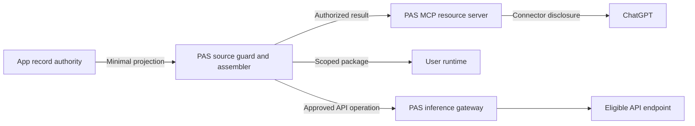
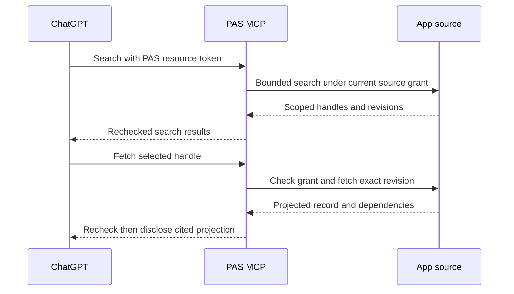
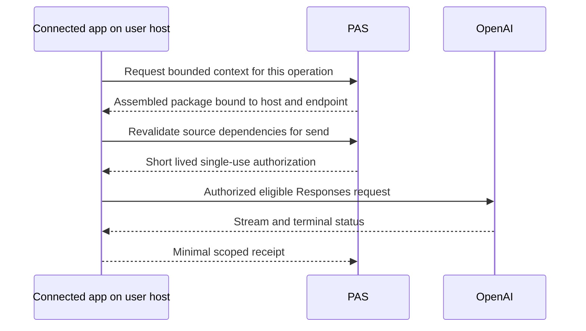
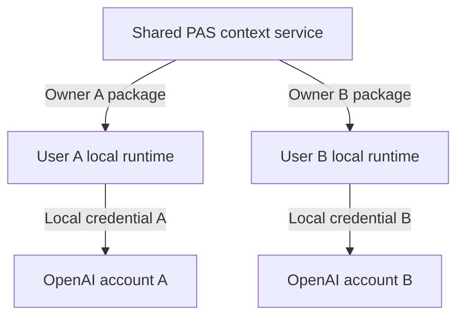

# Architecture and ownership

[DRAFT / NOT DEPLOYED](README.md). The diagrams describe proposed trust boundaries. Each arrow that carries records requires a current, recipient-specific disclosure decision.

**Connector read.** ChatGPT sees only model-readable records released for this connection. PAS checks even search titles before returning them.

**Plan inference.** The connected app initiates the turn. Physical send authority and token use belong to the selected user's runtime.

**Shared service and individual hosts.** The shared deployment may partition registry, policy, grant and receipt metadata by tenant. A host independently checks the initiating user, application, operation, package digest, expiry and replay fence. A host identifier by itself proves no control.

## Interface and ownership matrix

| Interface and owner | As implemented in this checkout | Target and change |
| --- | --- | --- |
| App → PAS identity and selection | [Client authority](../../backend/src/personal_ai/auth/application_clients.py) checks verified client/app bindings. [Consumer contract](../platform-independence/consumer-v1.md) and [HTTP tests](../../backend/tests/test_external_consumer_http.py) cover bounded consumer operations. [Registry](../../backend/src/personal_ai/applications/registry.py) composes manifests. | Reuse owner and membership checks. Introduce authenticated independent read providers with separate operator installation and owner grants. |
| App → context | Optional [reference apps](../../reference-apps/README.md) supply domain contributions. [Reading Logbook](../../examples/reading-logbook/README.md) owns its SQLite data. | Keep authoritative transactions, rules and UI in the app. Fetch projected records lazily. Initial scope has request-local buffers only and no replicated index. |
| PAS context → recipient | [Assembler](../../backend/src/personal_ai/context/assembler.py) accepts provider selections, budgets turns and handles branch history. [Retrieval guard](../../backend/src/personal_ai/retrieval/service.py) checks current installation and authority. | Translate records into existing candidates, carry grant epochs to final disclosure and preserve the active branch on edit/retry. Extend revalidation across the host boundary. |
| Memory and evidence | [Profile consent](../platform-independence/profile-sharing-v1.md) narrowly governs selected explicit preferences. [Memory policy](../../backend/src/personal_ai/memory/policy.py) governs memory admission. | Keep durable preferences separate. Time-sensitive external evidence needs observation time, rights and expiry. App revisions control current itinerary/workout facts. Summaries remain lossy and inherit dependencies for reuse. |
| ChatGPT → PAS | [MCP adapter](../../adapters/mcp_source/README.md) exercises synthetic retrieval with trusted host scope and no deployed connector authentication. [Adapter ADR](../decisions/0024-read-only-mcp-source-adapter.md) | New protected MCP edge maps read tools onto guarded reads. Preserve private API invocation behind this edge. |
| PAS → inference gateway | [Routing](../../backend/src/personal_ai/routing/service.py) owns authorization, reservations and dispatch. [Execution factory](../../backend/src/personal_ai/llm/execution.py) checks endpoint facts and rejects explicit paid mode. | Apply per-user restrictions inside the existing decision lifecycle. Extend accounting for verified monetary ceilings before paid admission. |
| User host → OpenAI | [Local bridge](../../backend/src/personal_ai/local_bridge/runtime.py), [Responses serializer](../../backend/src/personal_ai/llm/chatgpt/responses.py) and [lifecycle tests](../../backend/tests/test_chatgpt_local_lifecycle.py) already cover gated local execution, local state and unknown-send fences. | Reuse this prototype. Bind the connected app and source revisions at physical send. Prove host control and live compatibility for each admitted distribution. |

**DECIDED.** Provider SDKs stay behind adapters. The source owns truth, PAS owns selection, the user owns consent, and the approved host owns plan dispatch. Secrets stay out of content, traces, logs, backups of shared metadata and snapshots. **PROPOSED.** The [source protocol](application-context-contract.md), [connector and host controls](chatgpt-integration-boundaries.md) and [routing policy](inference-routing-policy.md) require the [acceptance gates](delivery-and-acceptance.md).
