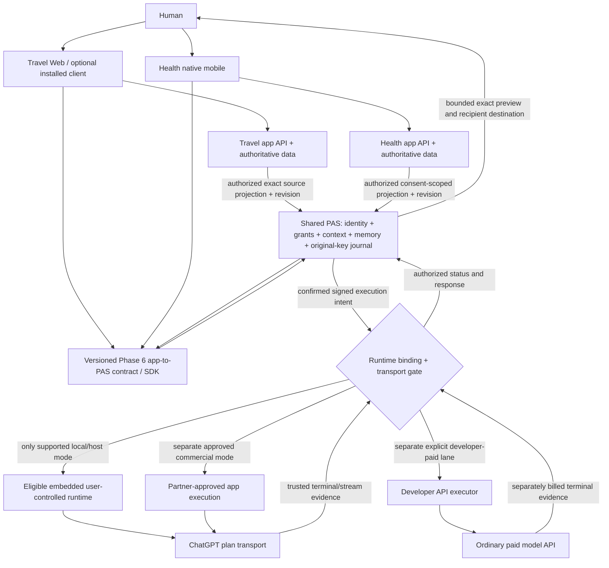
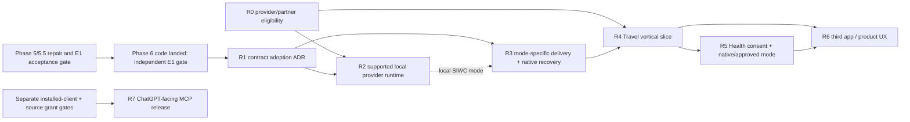

# PAS User-Controlled Inference Runtime — Final Design & Roadmap

**Status:** Finalized implementation roadmap, updated after the pushed Phase 6 implementation and review-fix commit. **Not** a production authorization or independently accepted E1/E2/E3 release.  
**Verified:** 2026-11-21 · PAS `main` HEAD `28bb98e4fe1071c8f4dff4896943b6c6b28a4a47` · Phase 6 implementation `0f2c34c06fe09a474547ff4c1b68bafaf37cbd52` · review fixes/evidence correction `28bb98e4`.  
**Source:** Astra-reviewed user-provided `pas-user-controlled-inference-runtime-design-roadmap-astra-review(2).md`, preserved and updated against current GitHub and provider references.  
**Companion deliverable:** `PAS_Runtime_R0_Codex_Handoff_2026-11-21.md` (the next phase).  
**Evidence caveat:** The user confirms Phase 6 review fixes are pushed. The current repository's own evidence still reports independent Phase 6 E1 acceptance as **unverified**, and three Phase 6 PostgreSQL cases as **collected/skipped, not E2 passes**. Do not change these statuses without a separate signed-off acceptance record. Live-provider E3 remains `NO_GO`.

## 0. Executive recommendation and key integration decision

**Goal:** Users open Travel or Health, use the non-AI app normally, and—where an actually supported provider mode exists—choose **Connect ChatGPT** without setting up, operating, monitoring or debugging a separate inference server. The app manages ordinary UX and code updates; the **human owns the account, consent and permitted execution**. No central PAS-hosted subscription gateway is created.

**Recommended shape:** A **single PAS private app-facing integration contract** (produced in the separate PAS-ChatGPT **Phase 6**) plus **platform- and eligibility-specific execution adapters**. Do **not** build a second preview/confirmation/original-key API in the user-runtime project. PAS can be centrally hosted for context, permissions, memory, sessions and journal; credential-bearing ChatGPT-plan execution must satisfy exact app/user/host eligibility and token-custody rules. Distinguish local runtime, approved participating commercial runtime and independently developer-funded API; never treat one as interchangeable for authorization or billing.

### Decision hierarchy

1. **Normal web consumer UX** (Travel): aspire to a **participating commercial SIWC plan-use arrangement**, **only when OpenAI explicitly supports/approves the exact app and execution topology**; no generic cloud token vault or developer-owned per-user container. Until then, default to **fully functional no-AI**, or offer a separate **developer-paid API** lane only if the product owner approves a hard budget and user disclosures. An optional packaged desktop build can demonstrate a locally supported subscription integration, but it is not equivalent to website-only UX.
2. **Installed local UX**: ship an **embedded runtime as part of a normal app installation** on a supported OS/app category; no terminal, Docker, manually provisioned VM, extra daemon manager or outside API key. Official examples currently concentrate on open-source local desktop (Electron) clients. Native mobile/Expo availability **must be independently established**.
3. **Shared platform**: one operator-managed PAS; per-app registration and source grants; on-device/provider adapter controls the user's SIWC credentials, eligibility and model call. The customer does not need to administer PAS.
4. **No AI**: first-class state if policy, model, cost, external approval, device capabilities or exact current authority is absent. No silent subscription/payer fallback.

**Implementation order:** **Phase 6 code and scoped review fixes are pushed**; independently close any remaining Phase 5.5/6 E1 and native E2 acceptance gates → **R0 provider eligibility/deployment research (next, read-only)** → R1 **adopt** accepted Phase 6 private HTTP/SDK contract (no new orchestrator) → R2 eligible local-runtime proof **for local execution only** and/or a separately supported commercial/API mode → R3 common native recovery plus the **selected mode's** confidential delivery → R4 Travel product slice → R5 Health consent/mobile proof → R6 third-app hardening. **R7 ChatGPT-facing MCP is independently gated and parallel**, not a prerequisite for in-app inference.

---

## 1. Background: why this architecture exists

### 1.1 The problem

A normal travel or health application owns records, sign-in, workflows and user experience. The user should not need to understand PAS internals, a local bridge, OAuth client IDs, token files, model catalogs, cloud VMs, or which worker process handled a turn. Yet a generic shared AI system must never use an account or private context without current user and app authorization.

The existing PAS architecture is deliberately split into (1) **apps and data**, (2) **shared context/memory/authorization**, and (3) **model execution**. That division makes one PAS useful across several free-first applications. The risk is over-coupling the third component to a specific provider or a central subscription proxy in pursuit of a frictionless web UI.

### 1.2 Product and security invariants

- **P0 / user experience:** no separately managed runtime for supported consumer modes; ordinary app installation and standard connect/disconnect UX are acceptable.
- **P0 / custody:** persistent SIWC authentication tokens never go into PAS, Travel/Health databases, shared remote queues, browser localStorage or developer-managed cloud vaults by default. Each account/host/app has a provider-permitted custody boundary.
- **P0 / connected app only:** a subscription authorizes the requesting person's connected app activity only. No account pooling, borrowing, app-to-app proxy, unrestricted generic PAS prompts or other users' requests.
- **P0 / consent:** domain source ACL, PAS source grant, PAS model recipient grant, exact preview and independent runtime/plan permission all matter. Login alone grants no cross-app memory or data use.
- **P0 / cost:** separate included allowance, optional credits, and developer-funded API charges. Never promise zero credit spend without enforceable eligibility evidence; no invisible route fallback.
- **P0 / turn correctness:** exact original key, immutable preview, current revocation at defined boundaries, durable local send-start guard, no automatic physical retry, trusted provider terminal, content-free unknown reconciliation.
- **P1 / generality:** Travel, Health, Fitness and Reading register source projections and app identity through the same PAS contracts; no app-specific router/provider engine in PAS.
- **P1 / app autonomy:** Travel/Health core operations and their domain-authoritative proposal/apply workflows work when AI is off. No direct model writes.
- **P1 / progressive delivery:** synthetic E1, scoped native E2 and live E3 are separate decisions. App-experience success ≠ provider compliance or deployed recovery.

### 1.3 Two directions, two sets of permissions

- **In-app inference** (this roadmap): Travel/Health → PAS preview/context/authorization → eligible app-bound runtime/provider → response to initiating app.
- **ChatGPT as a client of app data** (independently gated): installed ChatGPT plugin/MCP → protected PAS search/fetch → permitted app records. A successful MCP installation is **not** proof of SIWC plan usage, and SIWC does not grant MCP source rights.

---

## 2. Current code, evidence and integration surfaces

### 2.1 PAS actual current state — verified 2026-11-21

The current inspected PAS repository `main` commit is [`28bb98e4`](https://github.com/jasonkli21/personal-ai-system/commit/28bb98e4fe1071c8f4dff4896943b6c6b28a4a47), a direct child of Phase 6 implementation [`0f2c34c`](https://github.com/jasonkli21/personal-ai-system/commit/0f2c34c06fe09a474547ff4c1b68bafaf37cbd52), which followed Phase 5/5.5 repair `f059b822`.

- Phase 5 established the private shared application service, separate app/client identities, bounded source projections, source-side ACLs, consumer-v1.2 compatibility and multiple synthetic app contributions.
- Phase 5.5 established the private opt-in `user_owned_plan` branch, canonical PAS memory, frozen preview, exact confirmation, signed dispatch, synthetic app-paired runtime and a durable local send fence. The ordinary public server still does not mount this runtime.
- Phase 5/5.5 repair `f059b822` addressed R1–R5; the recorded native concurrent-witness case was skipped without a DSN, so this cannot stand in for E2 signoff.
- **Phase 6 implemented** the versioned private HTTP/ASGI app-inference profile, with two opt-in routes: `POST /private/application-plan/v1/conversations/{id}/context-preview` and `POST /private/application-plan/v1/conversations/{id}/continue`. Ordinary conversation create/status/detail remain on canonical `/v1/conversations` operations. The **Python `personal-ai-sdk==0.2.0`** adds an explicit `ApplicationPlan` extension. The ordinary external consumer **v1.2.0** and standalone source-free bridge are not silently upgraded to plan use.
- The Phase 6 implementer evidence reports **476 installed SDK/offline passes** and **five loopback/socket cases for each candidate distribution**, with no live provider calls. The **three Phase 6 PostgreSQL cases were collected and skipped**. Broader source/consumer and hermetic gates remained red in separately attributed areas. See the [dated Phase 6 evidence](https://github.com/jasonkli21/personal-ai-system/blob/28bb98e4fe1071c8f4dff4896943b6c6b28a4a47/docs/context-inference-integration/evidence/2026-11-21-private-application-inference.md).
- The pushed **Phase 6 review fix** `28bb98e4` changes preview-size validation to fail before a preview is published and corrects the evidence machine ledger: A13 native E2 is `not_run`; A01 acceptance remains `blocked`/waived for implementation only. This is **a pushed repair, not a provider/production approval**.
- The PAS current-state page still records **independent E1 acceptance unverified, E2 not_run for those native cases, and E3/hosted `NO_GO`**. Keep these labels until an independently recorded review supersedes them.

**Start points at exact HEAD:** `docs/current-state.md`; `docs/platform-independence/private-application-inference-v1.md`; `docs/context-inference-integration/evidence/2026-11-21-private-application-inference.md`; `backend/src/personal_ai/api/private_application_plan.py`; `backend/src/personal_ai/services/external_turns/application_plan.py`; `sdk/python/src/personal_ai_sdk/application_plan.py`; `backend/tests/test_private_application_plan_http.py`; and the existing local bridge README/runtime. Phase 6 HTTP does **not** create an independent confidential PAS→runtime channel.

### 2.2 Travel actual surface

Travel is web-first (Next.js + FastAPI + PostgreSQL). It already has a **read-only AI sidecar**, typed PAS HTTP client and `travel-context-read-v2` projection that caps fields and omits secrets such as confirmation codes/source documents. Travel owns trip membership, revision/freshness and final itinerary mutations. **Do not map a trip ID to a PAS workspace ID**; `workspace_id=null` remains meaningful. Legacy direct research/booking extraction/comparison/itinerary proposals use standalone `personal_ai` and must not be silently rekeyed. Travel's current sidecar does **not** demonstrate live plan inference under Phase 5.5.

### 2.3 Health actual surface

Health uses Expo/React Native + FastAPI + PostgreSQL, with **Firebase user identity**, granular `ai_use_allowed` and `cross_domain_use_allowed`, observed/revision/expiry constraints, read-only `health-context-read-v1` projection and default-disabled live Assistant endpoint. Its cross-app federation-export currently targets **narrow dietary→Travel and ergonomic→Shopping** sharing with signed delegated Google identity, not general model inference. Its local `AIContextPack` is not the external PAS source record wire format. Health's sensitive data, identity linking and mobile runtime require more proof than Travel.

### 2.4 Phase 6 ownership — implemented contract, subject to separate acceptance

| Problem | Implemented in Phase 6? | Runtime roadmap responsibility |
|---|---|---|
| Opt-in app→PAS versioned HTTP/ASGI client contract | **Yes**, synthetic E1, private and default-off | Adopt; don't fork API |
| Installable Python app SDK and original-key status | **Yes** | Extend compatible language/platform clients later |
| Existing PAS context, preview, confirmation, derived history and grants | **Expose/reuse existing**; no new engine | Recheck at physical runtime and provider send |
| Provider app registration, account OAuth, model catalog, plan eligibility | **No**, fake only | **R0/R2** with verified supported topology |
| Real confidential PAS→independent runtime transport | **No** | **R3** implementation and review |
| Native concurrent recovery across service and source stores | E2 only for specific tested stores | **R3** broader deployed restoration |
| Real Travel source and sidecar UI | **No** | **R4** |
| Health Firebase linking and native host | **No** | **R5** |
| Third-app onboarding | Reading fixture E1 | Genuine unrelated production app at R6 |
| ChatGPT-facing MCP | Separate pre-existing track | Separate R7 controlled admission |

**R1 compatibility milestone:** Once independent Phase 6 E1 acceptance is documented, create a short **contract-adoption ADR** enumerating the accepted SDK/OpenAPI version, server/consumer compatibility and invariant cross-platform semantics. It must contain **no duplicate implementation**. This is the runtime roadmap's *R1 exit*.

---

## 3. External constraints — confirmed versus unknown (official sources rechecked 2026-11-21)

### Confirmed from current official published sources

1. **[SIWC Terms, effective 2026-11-04](https://openai.com/policies/sign-in-with-chatgpt-terms/)** require supported token acquisition, local user-controlled persistence of SIWC authentication tokens, plan requests originating from a user's local or solely user-controlled remote runtime, no account pooling, no use of one user's plan for another user's requests, and use for the connected app only. Express user consent is required for authorized background usage.
2. The [open-source SIWC guide](https://developers.openai.com/siwc/token-sharing-open-source) and [official desktop example](https://developers.openai.com/cookbook/articles/sign-in-with-chatgpt) describe app-bound locally running tool integration and model discovery. A downloaded/packaged local app is a credible **technical probe**, but it still needs exact platform, license and registration verification.
3. The [website sign-in guide](https://developers.openai.com/siwc/website) documents an **identity** flow and states selected commercial partners / limited trial; identity sign-in alone is **not** an inference-plan execution grant. The [Help Center](https://help.openai.com/en/articles/20001542-using-your-chatgpt-plan-in-other-apps-and-sites) says **participating commercial apps/sites** may enable users with eligible plans to apply their allowance or optionally allowed credits. This describes an available product category, **not** approval of Travel, Health or PAS.
4. SIWC plan usage must not require a paid upgrade or charge from the application developer merely to use the ChatGPT-plan scope under the applicable Terms. Explicit optional credits and app-level usage controls may affect real charges; an included-only product preference must have a **provable implementation**, not simply a UI label. Separately authorized ordinary API billing has a distinct provider contract and developer cost.

### Unknown/unapproved until separately evidenced

- Whether a particular **Travel browser-hosted** website or this developer has partner SIWC registration and an approved remote execution/custody topology. A shared Cloud Run endpoint or developer-managed per-user container is not user-controlled merely because it isolates requests.
- Whether a **Health React Native/Expo native** platform can enroll and execute with ChatGPT plan scope under current official mobile support; OS Keychain/Keystore support is not itself provider approval.
- Whether a **browser-only user-controlled** SIWC runtime can comply with current browser-token and persistence guidance; do not put SIWC refresh tokens in browser localStorage or treat page JS lifetime as a durable execution fence.
- Exactly which models/plans/credits are currently eligible for these apps and whether an **included-only/no-credit** promise can be enforced.
- Provider terminal, receipt and usage attribution semantics of any commercial partner execution mode; never substitute a fake Responses parser result as live proof.

If any of these questions cannot be closed, return `blocked_external`/`unavailable` with a no-AI experience. Never simulate approval or enable hidden paid fallback. This is an architecture proposal, not legal advice or a blanket compliance certification.

---

## 4. Alternatives and tradeoffs

| Option | User effort | Subscription topology / eligibility | Advantages | Costs and risks | Decision |
|---|---|---|---|---|---|
| **A: App-embedded installed local runtime** | Normal install + connect; no separate process management | Closest to documented open-source local mode **on an eligible supported platform** | Local credential custody, independently deployed UI, no developer subscription token vault | Native packaging, auto-updates, OS secure store, app lifecycle, desktop vs web parity; mobile unverified | **Recommended local proof and installed-app architecture** |
| **B: Approved participating commercial SIWC website/app** | Website/app connect; ideal consumer UX | **Conditional on provider approval for exact app and physical runtime** | No user infrastructure, integrated browser Travel UX, plan use when eligible | Registration may not be available, hosting custody/commercial terms need scrutiny, costs/credits require exact controls | **Preferred browser product UX if approved, otherwise blocked** |
| **C: Pure browser JS SIWC executor** | None | **Not established** by the current local OSS documentation | No executable download, can use native browser UI | Browser token persistence/XSS, short-lived page, multiple tabs, device/host binding, uncertain eligibility | Research-only; no production promotion |
| **D: User-provisioned VM or self-hosted service** | High setup/ongoing maintenance | May meet sole-user-control in specific configurations; verify | Can run without local device foreground, user custody possible | User cloud account, bill, upgrades, secrets, network, recovery; conflicts with product UX | Power-user option, not default |
| **E: Separate PAS local companion daemon** | Extra installation/troubleshooting | Technically close to existing bridge where accepted | Reuse Python bridge, quick proof | Bridge availability/loopback risk, browser integration, long-term upkeep; violates no-separate-runtime ideal | Dev/test fallback only |
| **F: Developer-funded hosted API** | None | **Not ChatGPT plan usage** | Normal hosted user experience and broadly understood service operation | Variable developer costs/abuse, explicit model data terms, cost quota and billing | **Opt-in alternative**, default-disabled unless funded/bounded |
| **G: Central PAS-held subscription token vault / pooled plan gateway** | None superficially | **Not acceptable default** under current SIWC terms | Simple endpoint on paper | User-token locality and connected-app/user-isolation violations; cross-account risks | **Reject** |

### Consumer-path decisions

- Travel **web only** + ChatGPT plan → **B if approved**. Otherwise no-AI or a separately approved/budgeted **F**. A packaged desktop version **A** is an optional separate product; it does not magically remove the browser eligibility requirement.
- Health **installed mobile** → **A only if official mobile SIWC eligibility is proven**; otherwise use independently approved mode or no-AI. Do not use the desktop bridge as a hidden cloud proxy.
- First controlled provider-eligible technical proof → **A on officially supported local desktop** (after Phase 6 contract acceptance and live approval).
- User-managed VM and separate daemon are not consumer defaults. Developer may operate central PAS/Travel/Health backends normally, but not a token-sharing subscription broker.

---

## 5. Logical architecture and real deployment seams



**This is a logical target, not an approved deployed transport.** Phase 6 app→PAS HTTP is implemented, but PAS→independent-runtime delivery remains synthetic. Different provider arrangements may require direct client→provider transport or other approved topology; preserve **authorities and evidence**, not an invented universal wire. A signed grant is **not encryption**; exact release to the intended recipient needs authenticated confidential transport and current source/memory/owner authority. A browser-supplied runtime URL is never itself an authorization.

### Responsibilities

| Boundary | Owner | Required invariant |
|---|---|---|
| App UI and domain API | Travel/Health | Own domain records, record ACL/revisions, user workflow and final mutation; no generic provider credential storage |
| App→PAS client protocol | **Landed Phase 6** private profile v1 + Python SDK 0.2.0 | Two opt-in private POST routes, canonical create/status/detail, original-key journal; external consumer v1.2 unchanged; E1 acceptance to verify |
| Context/original intent | **PAS existing services** | One authorized assembler, source + PAS memory grants, destination-aware selected history, exact confirmation, root/witness and replay rights |
| PAS→runtime execution contract | **R3** | Confidential authenticated pairing and delivery; exact app/owner/runtime/host/device/account model binding, current authorization and revocation |
| Local credential-bearing execution | **R2** supported local host | OS-protected locally held SIWC tokens, official app-specific provider registration, exact eligibility, no credits if policy requires |
| Approved hosted plan execution | **R0** approval then conditional implementation | Provider-approved contract/physical topology; cannot assume developer-managed credentials accepted |
| Developer API execution | Future explicit option | Separate service token, billing quota, real data policy and consent; never mislabeled as included plan use |
| Output/recovery | PAS + selected adapter | Provisional deltas, provider-verifiable terminal, canonical status, original-key unknown, no duplicate physical sends |

### Runtime core — adopt Phase 6 contract after acceptance

Core responsibility: protocol verification, local connection lifecycle, exact app/host/account bindings, model/catalog/cost policy, durable local send-start/receipt status and provider result normalization. **Do not recreate PAS source grants, prompt/context assembly or original-key HTTP APIs.** Implement an adapter around Phase 6's accepted contract. Language choices should follow actual host/platform: retain Python local bridge semantics and evaluate an official TypeScript/Electron kit separately; preserve neutral schema conformance rather than prematurely mandate one universal runtime binary.

```ts
// Conceptual shape; NOT frozen Phase 6 wire schema or evidence of mobile support.
interface EligibleExecutionAdapter {
  describeSupport(app: AppBinding): Promise<EligibilityStatus>;
  connectBySupportedProviderFlow(app: AppBinding): Promise<ConnectionStatus>;
  verifyExactSignedIntent(permit: OpaquePASPermit): Promise<ApprovedExecution>;
  executeOnce(intent: ApprovedExecution): AsyncIterable<NormalizedEvent>;
  reconcileOriginal(originalKey: string): Promise<AttemptStatus>;
  disconnect(app: AppBinding): Promise<DisconnectResult>;
}
```

No `confirm()` that independently regenerates a PAS offer; confirmation belongs to the app/PAS Phase 6 contract. A commercial partner mode may not implement the same physical local storage semantics; require mode-specific approval and receipt evidence instead of making it pretend to be a local SIWC client.

---

## 6. User journeys and UI expectations

### 6.1 Connect once / no runtime administration

1. User opens Travel/Health normally. Core non-AI functions already work.
2. If this app/platform is **registered and actually supported**, user selects **Connect ChatGPT** and is told the difference between account sign-in, optional plan-use permission, source disclosure categories, included allowance/credits and optional separate developer-paid API mode.
3. User consents to exact app registration and account in the provider-approved flow. OS-supported local host retains its own credentials under user control, while PAS retains only non-secret opaque binding/status and grants. Website identity sign-in alone does not imply plan-use permission.
4. Runtime checks current catalog, eligible plan and included-only cost ceiling. If any uncertain, show unavailable/no-AI rather than offering a deceptive model label.
5. User can see connected account, where their data will go, provider mode and `Manage usage`/disconnect. Renewal and updates are automatic **within provider/platform permitted bounds**, not a promise that reconnection is never needed.

### 6.2 First real Travel question

**Question:** “Which Tokyo itinerary day fits Asakusa given my saved preference for a quieter morning?”

- Travel verifies trip owner and exports only approved typed `travel-context-read-v2` fields with revision/observed/expiry; exclude booking secrets, private attachments, confirmation codes. `workspace_id=null` remains distinct from trip ID.
- PAS resolves exact app/client/user, checks domain and PAS grants, assembles **once** one selected app projection plus one independently shared original PAS memory (and selected authorized history). Preview lists actual categories, fields, prior-turn count, onward provider destination, purpose and model, **without plaintext**.
- User confirms the exact frozen offer. PAS durably claims original intent and releases data only after current authorization, using confidential app-bound transport after R3. Runtime validates exact selected account/model/host/registration and current PAS authority under its durable send-start guard, then issues **one** eligible provider request.
- Model output is provisional until trusted terminal/receipt and canonical status match; current rights govern output, detail and replay. Travel renders advisory text and source references. Changing itinerary is a separate Travel typed proposal+approval/apply flow, not automatic memory or database write.
- If plan ineligible, app offline, source revoked, model unknown, provider charged route unapproved or send outcome ambiguous, Travel shows safe no-AI/unknown; no retry or alternate billing without a fresh user-approved independent intent.

### 6.3 First Health question

Only after Travel's common PAS/runtime contract stabilizes and Health's independent identity/privacy review passes: select a **single** small approved sleep/activity/other nonemergency wellness category from `health-context-read-v1` with Firebase owner, `ai_use_allowed`, `cross_domain_use_allowed`, current revision, temporal validity and strict field cap. Health's dietary/ergonomic export remains a **distinct targeted consent workflow**. A native mobile SIWC host is not presumed supported; if unsupported, Health stays no-AI or uses a separately accepted explicit funded API mode. Health retains authority for all writes, clinical decisions and proposal application.

### 6.4 Disconnect and failure recovery

- Stop new sends, remove app-specific local credentials and request remote revocation under supported flow; make any unconfirmed remote revocation explicit. PAS revokes runtime binding and grants as appropriate. Cannot recall bytes already sent.
- On device loss/suspension/offline, never mint a new original key to evade ambiguous send. Status is keyed to original intent; missing external authority denies new send. Multi-device uses separate installation/host/account credentials and grants; PAS never copies tokens between devices.
- Automatic updates are app release responsibility; provider credential rotation, consent changes and reauthentication may still require user action. “No runtime management” does **not** mean autonomous background plan usage or invisible account switching.

---

## 7. Threat model and correctness requirements

### Seven critical trust boundaries

1. App client identity ≠ human owner; Google/Firebase/PAS user linking requires issuer+subject+purpose-specific verifier, not email or caller header.
2. Source installation ≠ source consent; domain ACL, PAS source grant and destination-specific model/runtime grants each apply at current revision.
3. Canonical PAS memory ≠ domain data; origin membership, forget epoch, recipient and purpose are independently authorized. Never share across apps merely because same human uses both.
4. Preview != payload release; the exact frozen selected history, fields, model and provider recipient must be inventoried before consent. Signature != encryption.
5. PAS→runtime pair != arbitrary callback; exact app/host/device/installation/account/client, encrypted authenticated channel and runtime identity required.
6. Runtime→provider send != replayable POST; durable local send-start fence plus current PAS authority, model entitlement and credit policy; unknown outcome quarantined, no route fallback.
7. Provisional output != trusted completion; terminal and provider evidence, canonical status and current output/replay permissions required; model cannot directly mutate source application.

### Attack/failure matrix

| Negative scenario | Required evidence/behavior |
|---|---|
| Different owner, app or workspace uses same `r01` record ID | Deny before foreign record lookup; zero leaked titles/counts |
| Travel asks for Health memory via shared PAS without explicit grant | Zero unauthorized memory text in model input or output |
| Prior plan-only derived answer selected in ordinary strict-free followup | Exclude complete derived turn before assembly/summary and no leak |
| Preview forgets selected earlier user text | Deny confirmation until inventory describes same frozen package |
| Source grant revoked after preview or after release but before send | Zero new release or zero send, depending on boundary; keep required fences |
| Model, runtime, account, app registration, host or recipient switches | Deny exact permit; no credential from other app reused |
| Credits might be charged under included-only policy | Deny model execution when no enforceable zero-credit proof |
| Two tabs submit one key / stream interrupted | At most one physical send; opaque original-key status; no silent new key |
| Runtime crashes after physical send-start / local receipts restored older | Unknown/quarantine, no physical resend; independent send fence survives scoped restore |
| PAS root witness missing or partially overwritten across concurrent writers | Deny release/send absent **exact** per-claim witness; report actual native scope |
| Health Firebase user unlinked/mismatched with PAS Google actor | Deny before health source lookup; no email-only fallback |
| Browser JS injected/extension reads token | No SIWC token ever in ordinary browser app store for this design |
| Developer-hosted per-user container is labeled "user-controlled" | Not sufficient evidence of sole user control or plan eligibility |
| Paid API route becomes available after plan quota exhausted | No automatic fallback; separate cost consent and owner/developer budget required |
| Provider reports 429 or connection drops after attempt starts | Treat as unknown unless provider explicitly proves no send; preserve original attempt |
| Data deleted/revoked while output is streaming | Stop future PAS-controlled output/replay; cannot undo already observed bytes |

### Logging and storage

Log non-secret opaque attempt IDs, phase/state, count and bounded latency/error class only. Do not log raw prompts, PAS memory, health data, SIWC access/refresh/ID tokens, protected runtime payload, provider headers, sensitive record IDs, authorization URLs with hints or encrypted-but-recoverable secrets in centralized analytics. In-app/OS crash reporting and debug traces require redaction. Preview plaintext has bounded TTL and strict resource capacity; cleanup/expiry needs independent negative tests. Privacy deletion and source revocation cannot be equated with deleting an old receipt or reversing already disclosed bytes.

---

## 8. Execution lifecycle / state machine

```mermaid
stateDiagram-v2
    [*] --> Unavailable: No supported provider / consent / eligible runtime
    [*] --> Created: New foreground intent and persisted original key
    Created --> Previewed: Authenticated PAS frozen context
    Previewed --> Expired: No timely confirmation
    Previewed --> Confirmed: Exact user confirmation
    Confirmed --> Claimed: PAS durable root + exact independent witness
    Claimed --> Released: Current authority + confidential exact runtime delivery
    Released --> SendStarted: Local durable guard + current authority
    SendStarted --> Completed: Provider-proven terminal + matching status
    SendStarted --> Unknown: Ambiguous outcome, no resend
    Released --> Denied: Stale authority / eligibility / model
    Claimed --> Denied: Stale authority / recipient
    Completed --> [*]
    Denied --> [*]
    Expired --> [*]
    Unknown --> Completed: Trusted same-attempt terminal reconciliation
    Unknown --> Quarantined: No verifiable terminal; preserve fence
    Unavailable --> [*]
```



**Canonical meaning:** Landed Phase 6 tests the same lifecycle **through HTTP using fake runtime transport**; it does not implement the external Released→SendStarted physical topology. R2 proves a supported local send in the **local SIWC variant**; R3 proves native authorization/recovery and the selected execution mode's confidential transport (local pairing where applicable). Current revocation checks minimize but cannot eliminate final check-to-wire races. No exactly-once guarantee is claimed for an arbitrary remote provider; **at most one app-originated physical attempt under retained fences** is the implementable goal.

---

## 9. Consolidated roadmap — cross-repo, dependency-aware

### Baseline: Phase 6 and its review fixes are pushed; formal acceptance still needs explicit evidence

As of 2026-11-21, the Phase 5/5.5 repair `f059b822`, Phase 6 implementation `0f2c34c`, and follow-up Phase 6 review fix `28bb98e4` are present on GitHub. **The user's statement that the review fixes are done is accepted as implementation status.** The repository's published release ledger separately states that independent E1 acceptance is unverified and three Phase 6 native PostgreSQL cases were skipped. R0 is **research only**, so it can proceed immediately without treating those tests as passed. Do not begin live sourced integration, real credential transport or R2/R3 implementation until the appropriate contract acceptance and external provider eligibility gates are explicitly closed. E3 is still `NO_GO`.

### R0 — Eligibility and deployment decision log (**next; start immediately**)

**Primary work:** External official documentation and partner-inquiry **drafting only**; no outreach, approval requests, code, account changes or provider calls without separate authorization.  
Map supported exact app categories and host topologies: open-source Electron/local, other supported desktop, native iOS/Android, browser website, participating commercial app, remote sole-user-controlled VM, ordinary developer-funded API. Confirm per-app registration, identities, host controls, model catalog, included-only vs optional credits, terms and trustworthy terminal evidence. Record signed/written approval where required.  
**Output:** ADR + current eligibility matrix + fallback decision for Travel web/Health mobile.  
**Exit:** every mode labeled `documented_eligible`, `written_approved`, `unverified`, `blocked` or `rejected` for exact app/host; no blanket acceptance of a general PAS hosted SIWC route.

### Phase 6 — App-to-PAS integration contract (**implemented and reviewed-fixes pushed**)

**Primary repo:** PAS only; implementation at `0f2c34c`, fixes at `28bb98e4`.  
P6-00 baseline; P6-01 private HTTP/ASGI adapter; P6-02 existing plan lifecycle; P6-03 opt-in installed Python SDK 0.2.0; P6-04 multi-app HTTP/loopback synthetic witness; P6-05 docs/compatibility/evidence. Preserve external consumer v1.2, strict-free/default-off paths, no provider credentials and no live/managed SIWC. **Do not duplicate the contract under runtime R1**.

**Remaining gate:** independent E1 review/signoff must be evidenced separately; recorded Phase 6 native E2 cases are `not_run` and E3 `NO_GO`. Repair code on GitHub does not automatically approve deployment.

### R1 — Adopt the accepted Phase 6 contract (no new product subsystem)

**Primary repo:** PAS / runtime architecture ADR.  
Freeze *logical* fields for app/client/actor/workspace/runtime/recipient binding, preview categories, original key, model eligibility evidence and fake execution state. Compare actual published SDK with future TS/native feasibility. Choose minimum common schema and conformance tests; **reuse Phase 6**, do not implement a second HTTP server/state machine.  
**Output:** short compatibility ADR/versioned adapter contract.  
**Exit:** traceable map from Phase 6 API methods to R2/R3 runtime methods; no duplicate preview/claim authority.

### R2 — Supported local user runtime and real provider-proof

**Primary repo:** PAS reusable runtime package/verified desktop app host; Travel/Health remain unchanged.  
Extract only provider-facing runtime core from local bridge, with selected app host account binding, secure local credential store, OS updates, system browser login, model/catalog eligibility and included-only policies. Use official dev kit if license/platform applicable, retaining existing two-fence semantics. First run injected fake, then **one separately authorized live source-free** foreground request on an explicitly eligible supported local host; no personal app data sent during eligibility experiment.

**Output:** packaged supported local host, real model/entitlement/receipt demonstration with exact resource identity, safe disconnect and no manually operated daemon.  
**Gate:** external provider eligibility and actual user-control/custody; no provider call if unapproved.

### R3 — Common native durability and provider-mode-specific secure delivery

**Primary repo:** PAS plus the chosen approved provider execution adapter; Travel/Health retain their own authoritative source data and ACLs.  
Implement common PAS conversation/source-dependency/memory-grant/claim/receipt native durability and revocation, with **confidential authenticated delivery appropriate to the chosen mode**. A local SIWC execution mode requires exact app/user/host/installation pairing and user-held tokens; an approved commercial plan or separately developer-paid API mode may have a different physical route and billing/receipt authority, and must be verified on its own terms. No arbitrary callback server/URL, shared subscription-token vault or generic broker. Test independent processes, owners, restart/restore, native concurrent witnesses, partial streams, revoked output and no duplicate physical attempt.  
**Output:** E2 scoped to named real stores/processes and a mode-specific secure-delivery design; E3 requires separately confirmed provider/app eligibility, IAM, source authorization, terminal evidence and cost controls. **R2 is required for the local SIWC variant of R3, not for a separately approved hosted/API variant.**

### R4 — Travel's first real end-to-end user journey

**Primary repo:** Travel + PAS SDK/config + chosen accepted runtime adapter.  
Reuse `travel-context-read-v2` read-only sidecar, existing typed client, trip ACL, current revisions and field exclusions. Maintain `workspace_id=null` and legacy standalone research/booking extraction/proposal/comparison identities. Add accessible account/AI mode selector and exact context preview, original-key journaling, stream/status/unknown and no-AI. Use an actual authorized trip + separately approved PAS preference; app writes remain Travel-only reviewed proposal/apply. **Browser-hosted plan mode is blocked until partner approval**; otherwise optional separately budgeted API or an explicitly installed supported local client.  
**Output:** one useful Travel question through an **actually permitted execution mode**, tested revocation, restart and no-AI fallback. No need to complete every Travel feature to proceed to Health.

### R5 — Health-specific source identity and mobile/runtime proof

**Primary repo:** Health + PAS adapter/runtime only.  
Audit Firebase→PAS Google/owner mapping for exact issuer/subject/delegation and narrowly consented `health-context-read-v1` query. Keep separate the dietary→Travel/ergonomic→Shopping federation contract; it is not broad model permission. Start with one consented data category; default-off sensitive model recipient; exclude local `AIContextPack` as external interchange. Prove official native mobile SIWC eligibility, secure store and OS lifecycle, or choose a separately approved/controlled API/no-AI path. No inference-authoritative writes to Health.

**Output:** one controlled Health question through same Phase 6 contract, with independent privacy/device/identity approval. If mobile plan mode unsupported, report `BLOCKED_UNVERIFIED`, not a fake success.

### R6 — Genuine unrelated app and consumer-ready operations

**Primary repo:** PAS SDK + Travel/Health + third app contribution.  
Onboard unrelated Reading app through documented public API and app-specific source adapter (not fixture-only). Add SDK conformance for supported languages, version negotiation, source/retention limits, manual disconnect, model/account switch, usage visibility, non-secret telemetry, canary/rollback and normal host update strategy. Set realistic output/context limits using **measured** workload rather than Phase 5.5 synthetic 100-byte cap.  
**Output:** third app requires no PAS core routing code changes; product UX works with no extra user-managed runtime.

### R7 — Separately gated ChatGPT-as-client connector / rollout (parallel; not dependent on R6)

**Primary repo:** PAS installed-client MCP path and source applications.  
Complete independent installed ChatGPT/MCP resource/client auth and per-source search/fetch grants; don't inherit SIWC app-plan permission. Independently test source read, revoke/replay, identity and citation/redaction. Roll out guarded capabilities with separate E1/E2/E3 admission and incident playbooks.  
**Output:** authenticated ChatGPT→PAS→app data separately from app→PAS→ChatGPT inference; no automatic shared grant. **Dependency:** its own MCP installed-client/identity/source acceptance, *not* R6 completion.

### Dependency and parallelism diagram



**Parallelizable now:** R0 desk research and outreach **drafting (not sending without approval)**; Travel/Health API contract mapping; local host capability comparison; independent acceptance reconciliation for Phase 5/5.5/6. **Topology-specific:** R2→R3 for local SIWC; separately approved commercial/API modes need their own R3 delivery proof and not R2. **Not allowed by this roadmap:** live sourced runtime integration/credential deployment without accepted contracts and exact external eligibility.

---

## 10. Cross-repository deliverables and release gates

| Capability | PAS | Travel | Health | Provider/host |
|---|---|---|---|---|
| Private client/plan HTTP + Python SDK | **Landed Phase 6**, profile v1 + SDK 0.2.0, independent E1 review still open | No Phase 6 change; later adopt | No Phase 6 change; later adopt | Fake transport only |
| App identity and source rights | Existing shared authority + R3 deployed verification | Trip ACL/revision, service caller binding | Firebase owner and granular consent/delegation | Distinct SIWC identity and app registration |
| Runtime/account custody | Opaque signed intent/recipient; no tokens | Approved web or installed client | Verified native host/approved alternate | OS protected local / approved provider topology |
| Real data projection | PAS validates dependency/recipient grant | `travel-context-read-v2` owner and revision | `health-context-read-v1` consent and freshness | No unauthorized sharing |
| Fences and receipts | Native root/witness, original key, status | Durable caller journal, advisory response | Durable device resume and source revoke | Local physical fence and trusted terminal |
| User UX | Safe `unavailable`/`unknown`, no fallback semantics | Connect, preview, model/account, usage and no-AI | Narrow sensitive consent, disconnect, no-AI | Credit/plan eligibility and branding |
| Broad rollout | Distinct E1/E2/E3, private ingress and canary | Real trip only after gated E3 | Separate privacy/mobile proof | Per-app real registration and consent |

### Release gate matrix

| Gate | Must be shown | Remains NO_GO when |
|---|---|---|
| G0 Phase 5/5.5 baseline | Independent R1–R5 E1 review at exact SHA and relevant scoped E2 | Only repair self-test evidence; native DSN test skipped |
| G1 Phase 6 private API | `0f2c34c` and `28bb98e4` reviewed independently, versioned HTTP/ASGI + SDK 0.2.0, external consumer v1.2 unchanged | Review fixes mistaken for final E1; native skipped tests mistaken for E2; public/standalone plan exposure |
| G2 Provider eligibility | Explicit supported registration, connected app, actual host runtime/custody arrangement; written partner approval where necessary | Only identity sign-in or partner help-page existence verified |
| G3 Local/approved runtime | App-bound credential custody, model/credit eligibility, one provider-verified terminal/receipt | Tokens in PAS/remote broker; fake catalog; no included-only guarantee |
| G4 Confidential delivery | Authenticated exact PAS→runtime transport, current release/send authority, no arbitrary destination | Signed grant incorrectly treated as encryption; shared token proxy |
| G5 Native restore | Exact concurrent claims, database/host/receipt/witness restore and unknown fence on specified native stores | E1 fixtures or a small subset of PG cases used to claim full E2 |
| G6 Travel | Real authorized trip/context, source revision/revocation, stream/status and separate domain apply | Travel browser plan execution unapproved or domain writes model-authoritative |
| G7 Health | Real Firebase/PAS identity mapping, per-item consent, platform-eligible mode, privacy audit | Unapproved mobile plan mode, broad export, stale/revoked health data |
| G8 Product operations | Disconnect, token/account switch, usage, no-AI, supportable upgrades, default-off rollback, non-secret metrics | User required to manage separate daemon/VM for advertised normal UX |
| G9 ChatGPT-as-client | Separate installed-client registration and MCP source grants | SIWC permissions reused as MCP read authority |

**Evidence classes must be recorded separately:** static/documentary; E1 hermetic model & real HTTP app protocol; E2 exact native physical stores; E3 provider, deployed identity, billing and actual user-controlled host. A successful E1 private API does **not** imply eligible browser/native SIWC or a real deployed ChatGPT-plan executor.

---

## 11. Risk register / open decisions

| ID | Decision/risk | Default until evidenced |
|---|---|---|
| D1 | Participating commercial SIWC registration for free/small Travel website | **Unverified** → no plan execution; investigate R0; no web token vault |
| D2 | Health native iOS/Android/Expo SIWC plan support | **Unverified** → no plan execution; do not extrapolate Electron |
| D3 | Pure browser runtime/compliant storage and receipt fence | Research-only; no browser localStorage tokens |
| D4 | Developer-funded API conflicts with $0 spend preference | Disabled by default; enable only with explicit fixed spend/abuse guard and user disclosure |
| D5 | Which programming language for common runtime package? | Protocol-first; preserve Python existing bridge, adopt supported native client per host, no speculative universal binary |
| D6 | What is same user across Travel Google/PAS and Health Firebase? | Exact issuer/subject + signed purpose- and app-scoped linkage, never email-only |
| D7 | Can a provider guarantee included-only without optional credit consumption? | If uncertain, deny; not silent paid route |
| D8 | Commercial partner mode's terminal/receipt design differs from local Responses | Mode-specific evidence adapter; not falsely provider-attested |
| D9 | Plan preview plaintext retention and pending offers after disconnect | Bounded TTL, cleanup, process memory privacy, no provider leak |
| D10 | Original key across multiple devices / recovered local fence | Per installation/host binding + opaque status; no token copying or automatic rerun |
| D11 | Native source/memory/conversation restore vs test-only claim witnesses | R3 must test actual chosen backend; E2 scope documented |
| D12 | Existing strict-free/paid/free routing semantics conflict with plan mode | Explicit independent routes; no automatic paid/plan substitution |
| D13 | Health narrow cross-domain federation should be reused for model purposes? | No; new audited purpose/recipient authorization needed |
| D14 | Independent ChatGPT-facing MCP status and provider trust | Separate gate and grants, not blocked/accepted by SIWC Phase 6 |

---

## 12. Immediate R0 handoff and change control

The detailed **next Codex task** is in the companion downloadable `PAS_Runtime_R0_Codex_Handoff_2026-11-21.md`. R0 must produce a time-stamped provider eligibility matrix, architecture decision record (ADR), consumer-experience comparison, external decision/action queue, model/credit/receipt risk ledger and explicit R1/R2/R3 follow-on gate recommendations. It does **not** implement runtime code, change credentials, run live providers, spend money, contact partners or assume approval.

### R0 acceptance checklist

- Use the actual repository HEAD and distinguish **Phase 6 code pushed**, **independent E1 gate**, **native E2 not run**, and **live E3 `NO_GO`**.
- Document exact provider support for **OSS local desktop**, **Health native mobile**, **Travel browser**, **commercial participating app**, **self-hosted sole-user VM**, **separate local daemon**, and **developer-funded API**; mark unverified and unavailable modes rather than speculating.
- Separate **website identity sign-in**, **SIWC subscription-plan inference**, and **ordinary model API billing**. Never imply that signing in grants ChatGPT conversation/memory access or model usage without an explicit grant.
- Include an evidence-backed Travel and Health target/fallback choice and user costs; preserve the free/no-AI mode and default-disabled paid API fallback.
- Confirm what is required before an R2 **source-free** live experiment and before R3 physically releases PAS source/memory content. No credential or personal data transfer in R0.
- Record the specific unknowns requiring OpenAI approval rather than resolving them through code or inferred topology.

### Later work gates

R1 is a **small contract adoption ADR** after Phase 6 E1 acceptance; it must not create a second plan orchestration interface. R2 proves an eligible **local** user-controlled host only. R3 then implements common PAS native authority and a selected-mode confidential execution path. Travel R4 and Health R5 remain separate identity/source/platform acceptance decisions. ChatGPT-facing MCP R7 remains independent of this execution lane.

## 13. References, evidence classification and provenance

**PAS and app repositories (source verified 2026-11-21):**

- [PAS current inspected HEAD `28bb98e4`](https://github.com/jasonkli21/personal-ai-system/tree/28bb98e4fe1071c8f4dff4896943b6c6b28a4a47)
- [Phase 6 implementation `0f2c34c`](https://github.com/jasonkli21/personal-ai-system/commit/0f2c34c06fe09a474547ff4c1b68bafaf37cbd52)
- [Phase 6 review fixes and correction `28bb98e4`](https://github.com/jasonkli21/personal-ai-system/commit/28bb98e4fe1071c8f4dff4896943b6c6b28a4a47)
- [Current state](https://github.com/jasonkli21/personal-ai-system/blob/28bb98e4fe1071c8f4dff4896943b6c6b28a4a47/docs/current-state.md), [private profile v1](https://github.com/jasonkli21/personal-ai-system/blob/28bb98e4fe1071c8f4dff4896943b6c6b28a4a47/docs/platform-independence/private-application-inference-v1.md), and [dated implementation/review-fix evidence](https://github.com/jasonkli21/personal-ai-system/blob/28bb98e4fe1071c8f4dff4896943b6c6b28a4a47/docs/context-inference-integration/evidence/2026-11-21-private-application-inference.md)
- [Travel](https://github.com/jasonkli21/travel-app), [Health](https://github.com/jasonkli21/health-app)

**Official SIWC / provider sources checked 2026-11-21:**

- [SIWC terms](https://openai.com/policies/sign-in-with-chatgpt-terms/)
- [SIWC quickstart](https://developers.openai.com/siwc/quickstart); [local/open-source guide](https://developers.openai.com/siwc/token-sharing-open-source); [official local cookbook](https://developers.openai.com/cookbook/articles/sign-in-with-chatgpt)
- [Website identity sign-in](https://developers.openai.com/siwc/website) and [self-hosted VM guidance](https://developers.openai.com/siwc/token-sharing-open-source/self-hosted-vms)
- [Accounts and sessions](https://developers.openai.com/siwc/token-sharing-open-source/profiles-and-sessions), [errors/recovery](https://developers.openai.com/siwc/token-sharing-open-source/errors-and-recovery), [models/inference](https://developers.openai.com/siwc/token-sharing-open-source/models-and-inference)
- [Using ChatGPT plan in participating apps/sites](https://help.openai.com/en/articles/20001542-using-your-chatgpt-plan-in-other-apps-and-sites)

**Evidence classification:** `implemented` means present in source; `review-fix-pushed` means changes merged/pushed, not independent signoff; **E1** means private HTTP/synthetic model tests only; **E2** is limited to explicitly executed real native stores/processes (Phase 6's three PostgreSQL cases were `not_run`); **E3** requires real eligible app/host/provider, compliant token custody and confidential delivery, current app source grants, proven terminal/billing, and deployed acceptance. Product UX and provider availability remain separate evidence classes. This roadmap preserves the Astra-reviewed 2026-11-20 architecture and updates repository-status facts as of 2026-11-21; it is not a retrospective independent code review.

**Final thesis:** **Landed Phase 6 owns the app-facing contract; R1 adopts rather than duplicates it. Runtime execution is platform- and provider-eligibility-specific; PAS remains shared context/authorization infrastructure, not a pooled ChatGPT-subscription gateway.** User-facing seamlessness is a capability of a legally and technically supported topology, not a reason to move credentials into developer-managed backends. Travel and Health retain useful no-AI operation.
