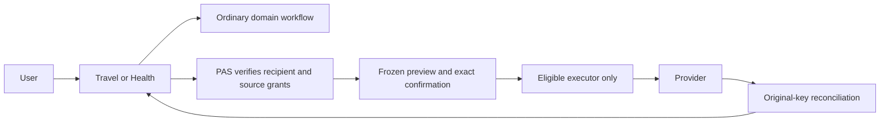
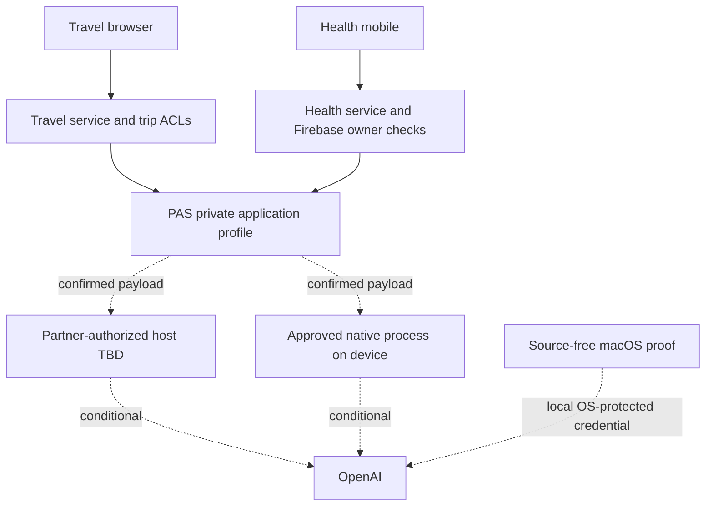

# Deployment decision for Travel and Health

**Provisional · 2026-11-21 · Product default approved by this design: ordinary domain features. Plan execution blocked pending external evidence.**

Travel should keep the browser-only experience. Select B, an approved participating website, only after written terms name Travel, its runtime, credential custodian and included-only control. Health should select A, an embedded runtime, only after eligibility is demonstrated for the actual iOS and Android builds. An independently approved B mobile agreement could enable the named platforms. Until then, both apps open normally and keep inference unavailable.

|Roadmap alternative|Decision and tradeoff|Revisit trigger|
|---|---|---|
|A · Installed local|Conditional first source-free proof on the documented macOS/Electron example. User owns credentials; operator owns signed packaging, upgrades and crash recovery.|License, registration, entitlement and spend gates close for exact build.|
|B · Participating commercial app|Preferred Travel route. Removes extra install but adds partner onboarding, incident response and custody obligations.|Written execution and operational contract per app/host.|
|C · Pure browser|Unverified. Page reloads, tab concurrency and renderer exposure complicate fenced execution and custody.|Provider documents browser registration, persistence and recoverable delivery.|
|D · Self-hosted VM|Reject consumer default. User must pay, secure, update and recover VM. Sole control may address request origin while leaving token persistence unresolved.|Provider reconciles local persistence with transfer; owner chooses a distinct self-hosted product.|
|E · Companion|Reject browser default. User installs and maintains another process; operator supports pairing and version skew.|Explicitly scoped desktop product with client-bound pairing.|
|F · Developer API|Disabled. Integrated UX trades plan eligibility for operator billing, abuse controls and separate data terms.|Budget owner approves enforceable cap, disclosure and separate opt-in.|
|G · PAS plan gateway|Reject pooled tokens and managed per-user vaults. Operator retains runtime access in either case.|Only evaluate a different, specifically authorized partner arrangement.|

No measured latency, hosting price or support-volume evidence exists for these products. R2 can measure the local path after authorization. Partner estimates depend on the agreed physical host.

### Logical flow

### Physical deployment

The solid domain paths serve the fallback. Source grants, PAS memory permission, provider authorization and domain writes have distinct owners. Travel and Health retain final write authority. Partner custody is unspecified until the agreement names it.

**Evidence · 2026-11-21.** [Decision matrix and source provenance](R0-eligibility-matrix.md), [private profile](../../platform-independence/private-application-inference-v1.md), [roadmap alternatives and deployment seams](PAS_User_Controlled_Inference_Runtime_Roadmap_2026-11-21.md).
