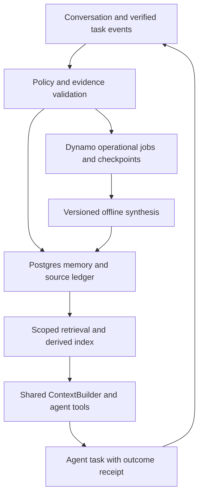

# Personal AI — Memory Architecture & Research Roadmap

**Status:** Proposed architecture and research program (not an implementation authorization)  
**Prepared:** 2026-10-28 (America/Los_Angeles)  
**Repository baseline:** [`jasonkli21/personal-ai-system`](https://github.com/jasonkli21/personal-ai-system), `main` at [`ad7c500`](https://github.com/jasonkli21/personal-ai-system/tree/ad7c5004294b34df6acffd154509a402e2626659)  
**Program identifiers:** `MEM-0` through `MEM-7` (provisional; not a claim that repository Phases 37–44 are assigned)  
**Primary references:** Databricks MemCurrent (2026-10-20), Databricks Agent Memory and Memory Pipelines, repository Phase 34/36 evidence.

> **Decision in one sentence:** Extend Personal AI's existing memory and context infrastructure into an auditable, scoped, provider-neutral system that can learn reusable knowledge from *verified experiences*, with measurement and safety gates ahead of autonomous consolidation and broad rollout.

## 1. Executive decision

The north star is **experience-conditioned improvement**: a returning agent should perform a later, related task better because of a previous task, without treating recollection as authority, silently learning unsupported claims, or requiring all history in the prompt. This includes user preferences, project state, domain-specific knowledge, successful procedures, corrections, and failed approaches. The goal is not merely to answer questions about old conversations.

The recommended order is:

1. Reconcile existing behavior and establish honest, task-level baselines (`MEM-0`).
2. Add a narrow, verified procedural/project-memory vertical slice (`MEM-1`).
3. Expose safe, authorized agent-facing memory operations (`MEM-2`).
4. Add selectively retained, searchable execution episodes (`MEM-3`).
5. Build incremental offline extraction and consolidation, or “dreaming” (`MEM-4`).
6. Research indexes, hybrid retrieval, and adaptive context loading (`MEM-5`).
7. Continuously evaluate and promote only measured improvements (`MEM-6`), then harden multi-agent/product capabilities (`MEM-7`).

`MEM-0` and `MEM-1` are the immediate priorities. Full trace capture and generative dreaming are *not* prerequisites to gaining useful procedural memory: existing completed turns and explicitly verified outcomes can support a first vertical slice.

### What this program does **not** do

- Does not adopt Databricks Lakebase/Managed Memory as a production dependency.
- Does not introduce an independent memory database, competing lifecycle engine, secondary context builder, or new domain authority.
- Does not let an LLM choose an owner/actor, expand a workspace scope, grant access, or designate its own unverified answer as a successful outcome.
- Does not copy unrestricted chain-of-thought, secrets, private tool payloads, or sensitive records into a permanent trace archive.
- Does not promote semantic similarity, model confidence, or a generated summary into evidence of truth.
- Does not equate synthetic success with native Postgres behavior, live task quality, or free-tier viability.

## 2. Verified repository baseline and the gap

The following is a *code-and-documentation assessment* at `ad7c500`, not a claim of deployed feature availability.

| Capability | Verified baseline | Implication |
| --- | --- | --- |
| Durable extracted memory | `memory/contracts.py` defines immutable original `Memory` records; `extraction.py`/`policy.py` admit narrow, exact, source-attributed user statements | Strong personal-memory foundation; extraction is intentionally conservative |
| Memory classes | `preference`, `episodic_observation`, `semantic_summary`, `explicit_correction`; derived records constrained to `preference`/`semantic_summary` | Missing first-class procedural, project, domain, decision, lesson, and outcome knowledge |
| Conversation history | Owner-scoped conversations/messages persist through DynamoDB; message storage exposes append-oriented contracts | Conversation history exists, but not a searchable step-level agent execution episodic corpus |
| Retrieval | `MemoryRetriever`, `MemoryQuery`, Postgres/pgvector, hard scope/source/lifecycle filters, bounded context injection and traces | Reuse this seam; task-conditioned retrieval, lexical/hybrid search, and hierarchical indices are not implemented |
| Provenance and invalidation | Original source fingerprints/turn IDs, derived-source edges, lifecycle validity epochs, permission revalidation | Preserve this exact authority graph when adding new origins and types |
| Consolidation | Existing coordinator, Dynamo job/lease execution, deterministic `support-v1` merging and conservative review events | Present behavior is *not* historical-session dreaming or broad generative reconciliation |
| Memory controls | Lifecycle supports forget/supersede/reactivate/review internally, with system/test actor model | No full general-purpose, user-authorized, agent-facing save/revise/forget tool suite yet |
| Deployment defaults | `memory_enabled`, extraction, consolidation, lifecycle worker and several related switches default `false` | Implemented code is not equivalent to an enabled production feature |
| Quality evidence | Phase 34 reports local/synthetic validation; Phase 36 says memory `fixed exact` remains default and optimization variants are unpromoted | Whole-task effectiveness, native resource consumption and some external acceptance remain open |

**Critical terminology:** `episodic_observation` currently means a distilled user statement such as “I visited…”. It is not a record of tool calls, decisions, intermediate artifacts, execution outcomes, and retries. Likewise, a searchable conversation is not automatically a trustworthy agent-experience log.

### Phase 34–36 constraints to honor

- Postgres is canonical for original/derived memory, lifecycle events/projections, source dependencies; DynamoDB for conversations and operational jobs/leases. The shared `ContextBuilder` owns packing. Domain applications retain their authoritative stores.
- Current extraction disallows broad categories of sensitive, financial, health, legal, external and assistant-derived information. New memory classes need **separate, explicit source-policy contracts**, not a relaxation of `memory/policy.py` across all memory.
- `DerivedMemory` has bounded source cardinality (2–4), exact support checks and schema-2 semantics. Generative, multi-episode knowledge will require a **versioned contract extension** and exhaustive provenance, not pretending it is an existing `support-v1` view.
- Existing `MemoryLifecycleEvent.actor` currently supports `system` and `developer_test`. User commands and agent proposals need explicit authenticated actor/intent provenance and conflict semantics without overloading that enum casually.
- Phase 34 explicitly rejects memory-bearing artifact writes without scope-aware revalidation. No memory-derived artifact feature may bypass that restriction.
- Phase 36's release report is **not release-ready**; native Postgres/Dynamo, live quality, identity, deletion and operational checks remain partly unverified/blocked. Offline research can proceed; production promotion cannot assume these gates are closed.
- Existing phase numbering ends at Phase 36 with no Phase 37 plan. Use `MEM-*` workstream identifiers until an explicit repository-wide sequencing decision is made.

## 3. Product outcomes and research hypotheses

### User-facing outcomes

1. **No repeated rediscovery:** The agent retrieves a verified project workflow or API quirk when a related task arises.
2. **Corrective learning:** A prior user correction or verified failure prevents a recurring mistake.
3. **Project continuity:** Architectural decisions and open issues are available with source revisions and dates, but are checked against current repository state.
4. **Transparent control:** A user can inspect, correct, suppress and delete relevant memories and understand why they appeared.
5. **Scope-safe reuse:** Authorized agents/applications can share reusable knowledge; unrelated owners, workspaces and domains remain isolated.
6. **Bounded overhead:** Retrieval and maintenance consume measured, enforceable time/token/storage budgets.

### Testable hypotheses

| ID | Hypothesis | Primary experimental signal |
| --- | --- | --- |
| H1 | Verified procedural memory improves downstream success on related multistep tasks | Paired task pass rate and avoided repeated errors |
| H2 | Source-aware project memory improves continuity without stale-context regressions | Currentness errors, abstention, source-version checks |
| H3 | Agent-callable memory tools complement automatic loading | Tool-call utility and answer/action quality by policy arm |
| H4 | Offline session synthesis finds useful knowledge that inline extraction misses | Novel, evidence-supported memories and downstream lift |
| H5 | Indexed/hybrid retrieval reduces cost at equal or greater quality as history grows | Quality–latency–cost Pareto frontier |
| H6 | Provenance, revocation and conflict gates reduce harmful memory reuse | Zero known unauthorized inclusion and stale/superseded use in adversarial suites |

Register the evaluation dataset, baseline revision, model/config identity, budget, scoring rubric and success criteria **before** comparing candidate variants. Negative findings are valid research outcomes.

## 4. Architectural principles and trust model

1. **Source evidence and derived knowledge are different.** Store original observation and execution-event references under their own owners; keep derived claims revisioned and replaceable. “Append-only” is logical history, subject to authorized deletion and retention.
2. **No invented authority.** User assertions, tested tool outcomes, retrieved external claims, internal model judgments, and canonical domain facts have distinct provenance and authority labels.
3. **The harness owns scope, policy and promotion.** The model may propose candidates or searches; trusted code resolves identity, authorizes source access, validates evidence and commits lifecycle changes.
4. **Scope before similarity.** Hard owner/app/workspace/actor, permission, source-branch, sensitivity, expiry and version filters run before ranking; retrieval results are revalidated before every use and downstream reuse.
5. **Outcome claims must be verified.** A successful procedure requires independent evidence (tests passed, tool receipt, artifact inspection or user confirmation), not the agent saying it succeeded.
6. **No silent policy migration.** Existing narrow extractive behavior remains the default. New categories, retention and multi-source summarization have versioned, separately gated policies.
7. **Reversible intelligence.** Derived views, indexes and recommendations must be reproducible or invalidatable from authorized original evidence. Forget and source revocation propagate to all derived consumers.
8. **Measured resource envelopes.** Small batch limits, per-actor checkpoints, timeouts, quotas, kill switches, backpressure and strictly free/opt-in paid-provider controls are required.
9. **Incremental integration.** Prefer current application registry, context provider, permission registry, Postgres memory repository and Dynamo lifecycle job patterns. Introduce only the storage/contracts the missing data class truly needs.

### Authority hierarchy (simplified)

| Source | May support a memory? | May be treated as current truth? |
| --- | --- | --- |
| Current canonical domain store or fresh verified source | Yes, with permissions and version | Yes, within its domain/source authority |
| User statement or explicit user instruction | Yes, with scope and privacy policy | For preferences/instructions; not automatically for external facts |
| Verified tool output or success receipt | Yes, with source/version/expiry | Only for that event/revision; recheck on later use |
| Agent inference or summary | Proposal only until evidence/support validation | No |
| Retrieved memory | Historical/advisory context | No; must be revalidated when task needs currentness |

## 5. Target architecture



This is a conceptual data flow, **not** a recommendation to duplicate the repository's production orchestration, source ledger or mutation authority. Existing service boundaries must be inspected and reused when implementation plans are written.

### 5.1 Four logical data planes

**A. Historical evidence plane**

- Reuse durable conversation/message records as existing evidence; do not bulk-copy whole messages into the memory table.
- Add a *minimal episodic execution-event contract* when `MEM-3` begins: run/task ID, ordered step ID, trusted operation/result category, tool/provider identity, redacted summary or permitted reference, timestamp, status, source-version fingerprint, permission dependencies and verification receipt. Never persist raw chain-of-thought. Captured tool I/O must have a dedicated allowlist/redaction policy; default is metadata-only.
- Event history should be append-oriented and branch-aware; support retention/physical erasure, deletion tombstones and revocation. Avoid an unbounded event-log volume commitment before sizing studies.

**B. Durable knowledge plane**

- Extend the current memory contract family with knowledge *kind*, *source authority*, *scope*, *subject/project identity*, *observed/effective/verified times*, *validity/expiry*, *source references*, *confidence and verification state*, *policy/version*, and optional structured procedure steps. Preserve existing v1/v2 records unchanged.
- Suggested kinds: `preference`, `user_correction`, `project_fact`, `domain_knowledge`, `decision`, `procedure`, `failure_lesson`, `outcome`, `historical_episode_summary`.
- Suggested operational trust states: `proposed` → `verified_active` → `superseded`/`review_required`/`forgotten`; a proposal rejected by the policy is never retrievable as advice. Keep review state and lifecycle validity distinct from source truth and from physical retention.
- Group related facts via scoped topic/subject IDs, not a free-form path that itself grants authorization. A file-like path may be a **navigation projection**, not an authority or canonical key.
- Represent citations as direct, bounded references to original messages, execution events, tool receipts or domain-version identities. For many-source synthesis, use a normalized provenance-edge relation; do not stretch the existing 2–4-source exact-consolidation schema.

**C. Operational/control plane**

- The existing lifecycle coordinator, Dynamo job leases and fenced commits orchestrate extraction, validation and maintenance. A dedicated *job kind* or versioned intent may be necessary; do not create a second scheduler/state machine.
- Model memory operations as idempotent intents with stable IDs, expected version/epoch, action actor (`verified_user`, `agent_proposal`, `system_pipeline`), policy version and source fingerprint. Handle CAS conflict by re-read/revalidate/reconcile, not last-writer-wins.
- A per-actor/session checkpoint records the last fully committed eligible source sequence (and its policy version); workers advance only after commit. Retries and overlapping jobs are safe and cannot silently skip a session.
- For cross-store workflows, explicitly enumerate prepare, publish, consume, commit, receipt and reconcile semantics. Do not assume Dynamo/Postgres atomicity.

**D. Query/context plane**

- Extend the existing `MemoryRetriever`/`MemoryQuery` and `MemoryContextProvider` rather than add a second injection pipeline. Add hard filterable types/project scope/authority/temporal requirements only when the corresponding implementation and tests ship.
- Provide automatic small-footprint recall **and** agent-initiated search/fetch. Inject at most a compact *index of topics and descriptions* at session start after authorization; fetch detailed memories on demand.
- Memory must retain its source references and age/currentness metadata when turned into `ContextItem`; the shared builder remains the only source of final token accounting.
- Keep derived topic indexes, inverted indexes, embeddings and caches rebuildable. An index entry cannot revive forgotten, deleted or newly inaccessible source content.

### 5.2 Public service contract (design sketch)

The model-facing surface should be smaller than the trusted application service; **the actor and scope never come from model arguments**.

```python
# Sketch only; not a drop-in API for the current repository.
scope = trusted_request_context()  # verified owner, app, workspace, actor, grants

memory.search(query, filters, limit, scope=scope)       # advisory, scoped, bounded
memory.fetch(memory_id, scope=scope)                    # revalidated content + evidence
memory.list_topics(scope=scope, limit=...)             # bounded descriptions/index
memory.propose(candidate, evidence_refs, scope=scope)  # agent/pipeline: no auto-trust
memory.save_user_instruction(candidate, scope=scope)   # authenticated user intent
memory.revise(memory_id, expected_version, revision, scope=scope)
memory.forget(memory_id, expected_version, scope=scope)
```

- Model tools may expose `search_memory(query)`, `fetch_memory(id)`, `list_memory_topics()`, `propose_memory(...)`, `update_memory(...)`, `forget_memory(...)`; trusted adapters bind identity and restrict which mutations are permitted.
- Direct user correction/deletion should have higher priority than background synthesis, but still obey tenant, permission, source and retention policy.
- Tool responses should clearly differentiate `saved`, `proposed_for_review`, `conflict`, `not_found`, `forbidden`, `stale_evidence` and `temporarily_unavailable`; no optimistic “saved” on an uncertain write.
- Search/fetch arguments remain bounded by an operation budget. The agent can never enumerate another actor's memories by guessing IDs or paths.

### 5.3 Verified-procedure format (proposed)

```yaml
kind: procedure
title: "Validate repository migration before release"
scope: {application: "repo-agent", workspace: "project-X"}
preconditions: ["Target revision and migration set are known"]
steps:
  - "Inspect migration ordering and ownership"
  - "Run repository's migration tests in the approved environment"
  - "Inspect receipts and reconcile failed/unknown outcomes"
observed_outcome: "Passed on revision abc123 under test profile T"
verification: {type: "test_receipt", source_ref: "receipt-id"}
limitations: ["Not valid for other schema revisions without rechecking"]
source_refs: ["event-id-1", "event-id-2"]
status: verified_active
```

Example fields/values are illustrative; this is *not* a claim the repository currently stores YAML procedures or that a remembered test pass authorizes production deployment.

### 5.4 Storage and ownership decisions

| Concern | Preferred owner | Rule |
| --- | --- | --- |
| Existing user original/derived memory, lifecycle, source edges | Postgres memory/lifecycle adapters | Evolve versioned schema and canonical provenance relations |
| New durable knowledge/procedure records | Existing Postgres memory ownership, via explicitly versioned contract | No parallel ungoverned “skills DB” |
| Conversations/messages | Existing DynamoDB conversation/message stores | Avoid duplicate raw conversation corpus |
| Task/execution episodes | Existing execution traces if sufficiently complete; otherwise scoped new event projection behind existing runtime ownership | Decide physical placement during `MEM-3` based on retention/access patterns |
| Async intents, leases, retry/checkpoints | DynamoDB existing job framework; canonical commit receipts in appropriate owner | Fenced, idempotent, replayable |
| Context injection and budgets | Shared context provider/assembler/builder | No independent prompt packing |
| Large permitted diagnostic bodies | Existing private artifact mechanism only after permission/expiry/reuse acceptance | Bounded, redacted; no unrestricted retention |
| Research metrics/datasets | Existing evaluation framework and approved artifact store | Traceable experiment versions; never production policy authority |

## 6. Security, privacy, lifecycle and failure semantics

### 6.1 Admission

- Distinguish **user-asserted** knowledge, **tool-verified** experience and **model-inferred** suggestions. Model-generated memories begin as proposals; promotion requires evidence and a matching policy.
- For `procedure`/`failure_lesson`, require at least one independently verifiable outcome signal. User-reported “this worked” can be stored as a user assertion, not relabeled as tool-verified success.
- Enforce source-rights and content-sensitivity filters before extraction and embedding; recheck before retrieval and before any background reuse. Do not use the old keyword regex as the entire new privacy defense.
- Exclude secrets/credentials, unapproved PII, protected records, raw tool payloads, and external copyrighted content by default. Opt-in sensitive memory would be a distinct future privacy/consent program, not an incidental change here.
- Prompt injection embedded in logs, webpages, memory text or tool results is untrusted *data*. Memory text may never issue system/tool instructions or authorize effects.

### 6.2 Revise, forget, delete

- **Revise** creates a new evidence/version-bound knowledge state; preserve audit history while eligible.
- **Supersede** hides a known-obsolete assertion, maintains the relation to replacement, and invalidates old cached/context-derived uses.
- **Forget** suppresses user-visible reuse immediately and advances validity; it must propagate through derived views, topic indexes, cached contexts, summaries and artifact-dependent references.
- **Delete/erasure** is a separate physical lifecycle action governed by existing account/deletion authority. Remove all eligible evidence/embeddings/derived content and handle backup/retention limits explicitly. Never promise physical erasure without a verified system-wide path.
- Background workers must be unable to resurrect a forgotten item from older evidence or stale checkpoints. Maintain revocation/tombstone epochs outside mutable generated text.

### 6.3 Failure table

| Failure | Required behavior |
| --- | --- |
| Memory DB unavailable | Advisory read degrades without fabricated memory; write reports unavailable/uncertain, never false success |
| Source permission or branch changed | Skip/invalidates memory; recheck before injection and reuse |
| Duplicate/overlapping job | Stable intent identity + lease fencing + idempotent commit |
| Crash after Postgres commit before Dynamo checkpoint | Reconcile receipt, replay harmlessly; never skip or double-apply |
| Ambiguous tool outcome | Keep outcome unknown; prohibit “successful workflow” promotion |
| Conflicting user/domain facts | Mark conflict with both sources, avoid autonomous authority resolution |
| Embedding model/index migration | Versioned, additive indexing and measured backfill; incompatible spaces fail closed |
| Token/latency budget exhausted | Return explicit incomplete result or bounded safe fallback, not a claim that nothing exists |
| Forget during retrieval or generation | Epoch revalidation at each supported reuse boundary; omit or halt stale memory |

## 7. Staged and phased development plan

The *stages* are product/research outcomes; `MEM-*` are executable increments. Every phase has a separate implementation plan, independent review, remediation and recorded evidence before moving on. Feature flags remain off unless a release gate authorizes them.

| Stage | Phase | Objective | Key deliverables | Prerequisite | Exit gate |
| --- | --- | --- | --- | --- | --- |
| 0 — Baseline | **MEM-0** | Reconcile actual baseline and build task-level evaluation | Capability map, typed benchmark corpus, no-memory/full-context/fixed baselines, report | Current repo at pinned revision | Reproducible results and explicit missing external evidence |
| 1 — Useful memory | **MEM-1** | Verified procedural/project memories | Versioned contracts, policy, Postgres persistence, scoped retrieval, tested vertical slice | MEM-0 | Grounded task improvement candidate; no scope/stale regressions |
| 2 — Agent control | **MEM-2** | Authorized agent-facing read/write/revise/forget | Trusted tool adapters, CAS/versioned lifecycle, user intent audit/inspection | MEM-1 | Concurrency, authorization and forget/revocation tests |
| 3 — Episodes | **MEM-3** | Safe, searchable step-level experience | Event schema, capture adapter, retention/redaction, source graph, event search | MEM-0/1/2 | Privacy, branch, replay, growth and retrieval verification |
| 4 — Dreaming | **MEM-4** | Incremental offline learning and conflict management | Actor/session checkpoints, proposal synthesizer, support validation, reconciliation | MEM-3 | Complete replay/idempotency and evidence-support gates |
| 5 — Retrieval research | **MEM-5** | Index/navigation and hybrid/contextual retrieval | Generated topic index, hybrid lexical+semantic variants, adaptive loading experiments | MEM-1/3; ideally MEM-4 | Held-out Pareto improvement with no regressions |
| 5 — Evaluation flywheel | **MEM-6** | Continuous research program and guarded promotion | Experiment registry, longitudinal harness, automated comparisons and rollback | MEM-0 onward; formalize after MEM-5 | Statistically defensible, repeatable end-to-end lift |
| 6 — Productization | **MEM-7** | Multi-agent governance and production readiness | Sharing grants, operator controls, native/cloud resource validation, deletion/soak | MEM-2–6 and old release blockers | Production gates satisfied, canary + rollback proven |

### Stage 0 / MEM-0 — Baseline, architecture reconciliation and evaluation

**Scope:** Primarily test harness, documentation and fixtures; no new automatic memory write behavior.

1. Inventory code/data contracts, all feature flags and migrations, current app integration, lifecycle transitions, known acceptance blockers and pending Phase 36 evidence. Pin a complete revision/config snapshot.
2. Define the benchmark record: `case_id`, owner/app/workspace, prehistory (turns/tool receipts), source permission changes, target task, expected actions/answer, prohibited actions, gold evidence, rubric, difficulty, privacy class and temporal anchors.
3. Prepare at least **30 initially hand-reviewed synthetic/masked multistep cases**, growing to 100+ before broad claims. Include 5+ cases per core family: workflows, project state, corrections, changing facts, permission/revocation, and memory-irrelevant tasks. Stratify by long history and cross-project contexts; keep held-out sets protected.
4. Evaluate no memory, current `fixed`, full available context where feasible, and a gold-memory ceiling; report retrieval *and task completion* separately. Add ablations as later phases ship.
5. Collect token counts, latency distributions, inference/tool calls, persistence bytes/operations where observable; mark native cloud/resource values `unverified` if absent.
6. Create a signed-off evaluation contract, fixtures/digests, scoring rubric and independent review record. Establish promotion gates (Section 8).

**Out of scope:** Changing default memory algorithm, forcing external cloud spend, claiming real-world lift from fixtures. 

**Acceptance:** Deterministic fixtures and replay; baseline metrics reproducible on the same model/revision; every negative/unknown case explicit; existing `make memory-eval memory-lifecycle-eval memory-optimization-eval` remains passing in supported environments; no newly enabled production capabilities.

### Stage 1 / MEM-1 — Procedural and project memory vertical slice (first implementation)

**Goal:** A second task can reuse a specific *verified* procedure or project decision from a first task, safely, without a new end-to-end trace platform.

**Deliverables:**

1. A short contract ADR choosing **versioned new knowledge records** versus an extensible new subtype in the existing family; migration and backward compatibility for `Memory` schema 1 and `DerivedMemory` schema 2. Keep current extractive paths unchanged.
2. Scoped kinds `procedure`, `project_fact`, `decision`, `failure_lesson` (start with a narrower subset if evidence requires); precondition, steps, outcome, limitations, provenance references, source-version and verification label.
3. Admission of verified outcomes from a *specific* completed-turn/test-receipt path and explicit user-confirmed project statements. A general model summarizer may propose but cannot self-verify.
4. Source-guard and permission revalidator coverage for these new records; lifecycle forget/supersede/review and derived invalidation. Extend Postgres adapters and in-memory fakes together.
5. Bounded `MemoryQuery` retrieval for allowed knowledge kinds, leveraging existing pgvector and context provider. Exact/default legacy personal-memory behavior must stay unchanged.
6. An operator/developer inspection path that shows memory text, scope, verification, source IDs and why it was selected or rejected; no public unguarded mutation endpoint yet.
7. 10–20 paired two-session task tests proving the core loop: verified task A → durable knowledge → related task B, plus negative cases where task A failed, domain state changed or sharing is forbidden.

**Recommended first demonstration:** A repository agent learns a *version-specific* verified test/migration workflow, then uses the procedure in a new session to avoid unnecessary discovery. On a changed repository revision, it must check the new state and qualify or abstain rather than blindly reuse the old steps.

**Explicit constraints:** Do not repurpose `episodic_observation` for tool traces; do not relax sensitive-data extraction broadly; do not embed private tool outputs wholesale; do not claim memory-generated artifacts are safe before the Phase 34 artifact revalidation gap closes.

**Acceptance:** End-to-end hermetic replay; exact source attribution; test-receipt/verification evidence for every `verified_active` procedure; denial or safe abstention on stale and unauthorized cases; idempotent creation/retry; no effect on existing `fixed` default; measured quality/cost against MEM-0 baseline. Hold production rollout until native store and current release prerequisites pass.

### Stage 2 / MEM-2 — Agent-facing memory operations

Implement two channels: (a) explicit authenticated user instruction/correction and (b) agent proposal. Trusted adapters bind scope; model-facing schemas cannot supply `owner_id` or rights. Extend event actor provenance and versioned lifecycle safely. Add search/fetch/list, propose, revise/forget, conflict handling, revalidation, bounded audits and a user inspection/review surface. Add concurrent update tests, idempotent retries, partial commit recovery, poison-content injection, wrong-actor access, and request cancellation. Do not allow arbitrary model overwrite of verified content.

**Exit:** All tool operations report actual durable outcomes; CAS conflicts do not erase newer writes; user forget invalidates retrieval/context reuse; abuse suite passes. Automatic memory use remains opt-in.

### Stage 3 / MEM-3 — Episodic execution event capture

Define and build a minimal event recorder, primarily for already trusted, completed, selected task operations. Capture step ordering, tool IDs, normalized outcome categories, result receipts and permitted/redacted payload references; do not persist full reasoning or indiscriminate tool responses. Design a retention and source-privacy budget first. Link episodes to user/session/task/branch and canonical source references. Index only eligible, completed or explicitly classified events. Test source revision, abort, retry, secret redaction, owner isolation, size growth and deletion.

**Exit:** Given an authorized task ID, the agent can find the relevant historical step, inspect its verified evidence and limitations, and the system can revoke it without leaving a retrievable copy.

### Stage 4 / MEM-4 — Offline “dreaming”

Build bounded, incremental per-actor/session processing on the existing job framework:

1. Discover eligible completed sessions/events since a checkpoint.
2. Retrieve authorized sources within a bounded window; redact/minimize.
3. Generate typed *proposals*: new lessons/procedures, changes, conflict candidates, topic merges/splits.
4. Validate every proposal against exact source references, known outcome receipts and policies; unsupported or contradictory syntheses go to review/no-op.
5. Commit with expected versions and a stable source/policy identity, then advance checkpoint and emit audit receipt.
6. On reprocess, dedupe and reconcile partial work. On source revoke, recompute only affected derived nodes and indexes.

Keep the deterministic existing consolidator as the default. A model-assisted consolidator is a separate experimental policy, never an opaque rewrite of canonical knowledge. Compare online-only, offline-only, and combined arms under frozen conditions.

**Exit:** Checkpoint replay does not skip/double-apply eligible sessions; every promoted memory is evidence-supported and scope valid; conflicts are surfaced; downstream improvement exists on held-out tasks without harmful regression.

### Stage 5 / MEM-5 — Memory index, retrieval and context research

Experiment with a *generated* compact topic index (analogous to `memory.md`), lexical+vector hybrid search, metadata and temporal filters, query expansion, reranking, hierarchical retrieval, fetched-episode backoff, adaptive token budgets and model-aware candidate selection. All variants must use the existing context-builder accounting and revalidation. Never make a file path a scope proof. Preserve exact source IDs, filter first, measure after final packing. For small histories, full-context can be a stronger baseline than retrieval; do not assume RAG wins.

**Exit:** Candidate policy is on the task-quality / token / latency / cost Pareto frontier against existing fixed retrieval and full-context where feasible, with no authority, omission, stale-memory or revocation regressions.

### Stage 5 / MEM-6 — Continuous research and promotion

Make a durable research loop: versioned datasets and run manifests, ablations, model/provider cross-tests, fresh held-out episodes, longitudinal histories, drift/poisoning tests, blind scoring, independent reproducibility review, shadow/canary rollout and rollback. Hypotheses that fail should be recorded and retired. Keep selection policy modular so new extraction/consolidation/retrieval strategies can be compared without replacing canonical storage.

**Exit:** Reproducible end-to-end lift, bounded resources, acceptable uncertainty intervals, no critical safety regression, positive evidence on more than synthetic recall, and live/native evidence for promotion.

### Stage 6 / MEM-7 — Production governance, multi-agent reuse and scalability

Add explicitly granted cross-agent/project sharing, versioned ACLs, privacy/retention controls, export/delete propagation, operational quotas, maintenance observability, native Postgres/pgvector and Dynamo failure/soak evidence, deployment canary/rollback and cost guardrails. Start with personal/free-tier envelopes; introduce paid capacity only behind explicit admission and an economically justified use case. Product-facing sharing is a new trust boundary and must not be inferred from shared physical storage.

**Exit:** Phase 36 legacy blockers relevant to memory and all new critical gates are closed with appropriate local/cloud/live/domain receipts; owner deletion verified, not merely logically hidden; durable resource viability measured; no feature ships on fabricated synthetic equivalence.

## 8. Evaluation and promotion contract

### 8.1 Comparison arms

1. No persistent memory.
2. Full eligible historical context (only where it fits; never leak suppressed data).
3. Existing fixed semantic retrieval (`ad7c500` baseline).
4. Verified procedural/project knowledge, auto-loaded.
5. Verified knowledge with agent search/fetch tools.
6. Raw permitted episodes only.
7. Online extraction only vs offline dreaming only vs combination.
8. Hybrid/indexed/adaptive retrieval variants, and selected combined systems.

Keep the same task input, source permissions, model, provider, tool budgets and randomized seeds within each paired comparison; document when provider non-determinism prevents strict equivalence. Gold evidence injection is a diagnostic ceiling, not an installable product baseline.

### 8.2 Metrics, by level

| Level | Metrics | Why |
| --- | --- | --- |
| Memory capture | useful-supported candidates/eligible session, exact attribution, extraction precision, sensitivity false admission | Separates what was learned from what was imagined |
| Retrieval | recall@K, precision@K, MRR/nDCG if meaningful, source coverage, omission, stale/superseded/unauthorized hits | Measures relevant and permitted context |
| Agent task | rubric pass rate, correct tool actions, retries/duplicate side effects, time to solution, repeated-error rate, abstention calibration | Central product outcome |
| Reliability | contradiction rate, unsupported derivations, cross-actor leakage, source revocation/forget correctness, poisoning resistance | Safety and trust |
| Efficiency | input/output tokens, model/tool calls, p50/p95 latency, native DB read/write/bytes, maintenance jobs, provider costs, storage growth | Sustainable operation |
| Longitudinal | benefit as sessions accumulate, old-memory decay/staleness, update recovery, topic-index size, correction durability | Does it keep learning? |

### 8.3 Evidence policy and provisional gates

- **Hard blockers:** Any reproducible cross-owner/app/workspace leak, unauthorized source use, resurrection after forget, false claim of committed writes, or unverifiable automatic procedure promotion. Fix before a positive quality claim.
- **Quality:** Compare on held-out *task execution*, not just recall. Report absolute and relative pass-rate changes, confidence intervals/variance across repeats, regressions by case family, and failure taxonomy. Do not invent a minimum lift before the baseline distribution is measured; preregister a practical effect threshold after MEM-0.
- **Cost:** Require a measured Pareto case or justified task-quality gain for any higher spending. Cap per-request tokens and synchronous read time; report shadow/offline maintenance separately.
- **Native evidence:** Synthetic/replayed tests are necessary but not proof of cloud DB cost, concurrency, provider privacy, IAM or deletion. Promote only with the required evidence tier.
- **Rollback:** Every experimental variant has a versioned feature flag, a previous stable policy to restore, compatibility for stored records and a test that rollback disables selection immediately.

### 8.4 Benchmarks and dataset roadmap

- **LoCoMo:** long-horizon recall, event reasoning and summaries.
- **LongMemEval:** information extraction, multi-session and temporal reasoning, updates, abstention.
- **ConvoMem:** evolving user facts, implicit connections and long-context-vs-RAG comparison; especially useful to test the “RAG is always better” assumption.
- **LongMemEval-V2:** candidate supplement for environment-specific, trajectory-based agent experience; verify applicability/license/fixtures before integration.
- **Personal AI task suite (most important):** pair real or carefully masked synthetic repository workflows, API edge cases, project decisions, recovery after failed effects, cross-session corrections, scoped domain tasks and injected conflicting evidence. Keep evaluation artifacts sanitized, reproducible and consent-appropriate.

## 9. Research agenda beyond the first product release

| Direction | Questions | Candidate methods | Failure mode to study |
| --- | --- | --- | --- |
| Experience selection | What is worth retaining? | Outcome-aware utility classifiers, novelty/recurrence scoring, counterfactual value | Storing trivial/failing/noisy experiences |
| Knowledge representation | Facts vs skills vs episodes? | Structured procedures, event snippets, hierarchical topic views, support graphs | Overspecialization or invented general rules |
| Consolidation | When can experiences be safely merged? | Evidence-constrained synthesis, versioned claims, contradiction review | Erasing qualifiers, source provenance or minority exceptions |
| Retrieval | What to load automatically vs on-demand? | Topic index, hybrid search, entity/time filters, contextual reranking | Irrelevant context crowding out fresher evidence |
| Temporal truth | When does knowledge become stale? | Source-version binding, effective-time models, evidence invalidation | Historical truth misreported as current |
| Security and privacy | Can memory be poisoned or overshared? | Typed policy, taint labels, redaction, adversarial eval | Tool-output prompt injection, cross-agent leak |
| Memory economy | How much memory is enough? | Value-weighted retention/eviction, adaptive budgets, storage accounting | More maintenance than task benefit |
| Causal utility | Did memory actually help? | Paired task runs, memory ablations, oracle/gold ceilings | Attribution to model variance rather than memory |

**External research watchlist:** MemCurrent/Managed Memory; Mem0; Letta; Graphiti/Zep; other relevant open memory systems. Comparison should assess actual source contracts, update semantics, benchmarks, privacy and cost rather than architectural marketing. Review periodically, but do not make feature delivery contingent on copying a competitor.

## 10. Cross-project integration boundaries

- **Context Integrity:** Potential future producer of provenance validation, contradiction/drift alerts, source-dependency audits and replay evidence. It should return advisory findings via versioned contracts; Personal AI still owns admission, authorization and memory lifecycle decisions.
- **Context Engine:** Potential future producer of codebase symbols, change detection, repository version identities and scoped retrieval. Codebase indexes remain domain/context evidence, not automatically personal memory. Persist project decisions/procedures only with proper source and freshness semantics.
- **Agent Safety & Security:** Potential future adversarial test corpus, injection-risk scoring and policy evaluation. It must not become an uncontrolled external mutation authority for memory.
- **Adaptive Dataflow Engine:** Optional research/optimization substrate for batch extraction or maintenance later; no new runtime dependency while bounded Dynamo jobs suffice.
- **Personal AI harness:** Owns user/application identity, storage, lifecycle policy, context orchestration and experiment promotion. Cross-project integrations are opt-in behind provider-neutral interfaces and independent conformance suites.

Integration should begin only after each project has a stable standalone contract. Do not share tables or call private modules across repositories merely to achieve early coupling.

## 11. Risks, open decisions and sequencing rules

| Risk / decision | Proposed default | Resolve no later than |
| --- | --- | --- |
| New knowledge schema design | Versioned Postgres memory contract, retain v1/v2 read compatibility | MEM-1 ADR |
| Can any model-proposed lesson auto-promote? | No; verified evidence/policy required, ambiguous cases review-only | MEM-1 |
| User-facing writes vs model writes | Distinct provenance/authorization; CAS/versioned lifecycle | MEM-2 |
| Step-event physical storage | Evaluate existing runtime traces first; choose from access/retention profiles | MEM-3 ADR |
| Retention and privacy of tool data | Metadata-only by default; explicit allowlist and erasure plan | Before MEM-3 implementation |
| Per-actor/session checkpoint design | Stable replay keys, fenced commitment, versioned policy | MEM-4 |
| Multi-source generated views | New versioned source-edge support, never fake `support-v1` eligibility | MEM-4 |
| Memory index as canonical truth? | No, always rebuildable projection | MEM-5 |
| Autonomous cross-agent sharing | None without explicit grants | MEM-7 |
| Paid inference/embedding usage | Free/near-free preference; explicit opt-in + hard limits | Every phase |
| Release readiness | No promotion until relevant Phase 36 and new evidence gates close | MEM-7 (or any earlier production gate) |

**Phase dependency rule:** Start `MEM-0` immediately; `MEM-1` may follow an accepted baseline. `MEM-2` builds on stable knowledge/lifecycle semantics. `MEM-3` can prototype event capture alongside `MEM-2`, but no public episodic retrieval until security and identity controls are complete. `MEM-4` needs trustworthy events and checkpoint semantics. `MEM-5` experiments may run in parallel on offline fixtures, but production index promotion requires source invalidation correctness. `MEM-6` starts as part of `MEM-0` and becomes a formal promotion system after comparative methods exist. `MEM-7` is gated by both new and inherited release criteria.

## 12. Immediate next actions and handoff checklist

### Suggested next Codex handoff: `MEM-0` (Sol High for architecture/eval plan; Luna High for bounded fixture implementation; Sol High independent review)

1. Pin repository HEAD and map existing contracts/flags/migrations/tests and Phase 36 blocker rows.
2. Write `memory-architecture-adr.md` with a decision record for current/new knowledge types, strict source policy, scope and pending schema alternatives; no premature migration.
3. Write `memory-benchmark-contract.md` and a first 30-case synthetic/masked task corpus using existing evaluation conventions; define blind scoring and unknown-result semantics.
4. Run no-memory, fixed-memory, full-context-feasible and gold-injection baselines; retain exact model and runtime identity, token/call counts and case outcomes.
5. Produce a gap/uncertainty report separating implemented code, off-by-default capability, synthetic observations and native/live blockers.
6. Commission independent review of fixture representativeness, leakage/adversarial coverage, source authority, scorer reliability and benchmark overfitting.
7. Then create a **separate, executable `MEM-1` implementation plan and review prompt**. Do not ask an implementation agent to complete the entire multi-year roadmap in one phase.

### Definition of ready for MEM-1

- Pinned and reviewed baseline, source ownership map and versioning ADR.
- Pre-registered task-level cases and safety checks.
- Clear permission and outcome receipt contracts for at least one end-to-end source.
- Native Postgres migration/concurrency tests specified, even if execution requires a later authorized environment.
- Rollback/default-off behavior, resource budgets and no-new-authority invariants documented.

### Definition of done for each phase

An implementation and independent review should include: architectural ownership and extension seams; precise contract/schema changes and migration compatibility; idempotency/concurrency/uncertain-effect semantics; threat/permission/sensitivity analysis; test corpus plus negative/adversarial cases; performance/cost/resource evidence by tier; exact executed commands/results; known gaps and unverified items; feature-flag rollout and rollback; updated architecture/readme/decision records. Distinguish **implementation complete**, **offline-verified**, and **production-promoted**.

## 13. Sources and repository anchors

**External primary references**

1. [Databricks AI Research — MemCurrent: Designing Persistent Memory for Production Agents](https://www.databricks.com/blog/memcurrent-designing-persistent-memory-production-agents) (2026-10-20): episodic/derived memory, automatic and tool-based access, offline dreaming, memory index, research benchmarks and reported ablations. Databricks' reported performance is **not** evidence for this repository.
2. [Databricks Agent Memory API](https://docs.databricks.com/aws/en/agents/agent-memory/managed-memory) (Beta, updated 2026-10-26): actor-scoped entries, path/description/search and tools; note its documented non-atomic `put()` warning is one reason to design CAS behavior explicitly.
3. [Databricks Agent Memory Pipelines](https://docs.databricks.com/aws/en/agents/agent-memory/memory-pipelines): offline incremental session synthesis/checkpoint reference.
4. [LoCoMo](https://aclanthology.org/2024.acl-long.747/), [LongMemEval](https://arxiv.org/abs/2410.10813), [ConvoMem](https://arxiv.org/abs/2511.10523), [LongMemEval-V2](https://xiaowu0162.github.io/longmemeval-v2/): benchmark candidates; compare their actual evaluation protocols and licensing.

**Pinned repository references** (`main` at `ad7c500`)

- [`backend/src/personal_ai/memory/README.md`](https://github.com/jasonkli21/personal-ai-system/blob/ad7c5004294b34df6acffd154509a402e2626659/backend/src/personal_ai/memory/README.md)
- [`memory/contracts.py`](https://github.com/jasonkli21/personal-ai-system/blob/ad7c5004294b34df6acffd154509a402e2626659/backend/src/personal_ai/memory/contracts.py), [`memory/policy.py`](https://github.com/jasonkli21/personal-ai-system/blob/ad7c5004294b34df6acffd154509a402e2626659/backend/src/personal_ai/memory/policy.py), [`memory/extraction.py`](https://github.com/jasonkli21/personal-ai-system/blob/ad7c5004294b34df6acffd154509a402e2626659/backend/src/personal_ai/memory/extraction.py), [`memory/services.py`](https://github.com/jasonkli21/personal-ai-system/blob/ad7c5004294b34df6acffd154509a402e2626659/backend/src/personal_ai/memory/services.py)
- [`memory/lifecycle/contracts.py`](https://github.com/jasonkli21/personal-ai-system/blob/ad7c5004294b34df6acffd154509a402e2626659/backend/src/personal_ai/memory/lifecycle/contracts.py), [`memory/lifecycle/jobs.py`](https://github.com/jasonkli21/personal-ai-system/blob/ad7c5004294b34df6acffd154509a402e2626659/backend/src/personal_ai/memory/lifecycle/jobs.py), [`memory/dependencies.py`](https://github.com/jasonkli21/personal-ai-system/blob/ad7c5004294b34df6acffd154509a402e2626659/backend/src/personal_ai/memory/dependencies.py)
- [`docs/personal-ai-chapter-2/phase-34-implementation-report.md`](https://github.com/jasonkli21/personal-ai-system/blob/ad7c5004294b34df6acffd154509a402e2626659/docs/personal-ai-chapter-2/phase-34-implementation-report.md), [`phase-34-independent-review-remediation-evidence-2026-10-12.md`](https://github.com/jasonkli21/personal-ai-system/blob/ad7c5004294b34df6acffd154509a402e2626659/docs/personal-ai-chapter-2/phase-34-independent-review-remediation-evidence-2026-10-12.md)
- [`docs/personal-ai-chapter-2/phase-36/architecture.md`](https://github.com/jasonkli21/personal-ai-system/blob/ad7c5004294b34df6acffd154509a402e2626659/docs/personal-ai-chapter-2/phase-36/architecture.md), [`phase-36/release-report.md`](https://github.com/jasonkli21/personal-ai-system/blob/ad7c5004294b34df6acffd154509a402e2626659/docs/personal-ai-chapter-2/phase-36/release-report.md)

---

**Recommended decision:** Approve this as a *research roadmap*, execute `MEM-0` for a reproducible baseline and review, and then scope `MEM-1` as a narrow, provenance-bound procedural-memory vertical slice. Revisit later phase ordering after those results; keep the longer-term aspiration broad and the next implementation increment small.
