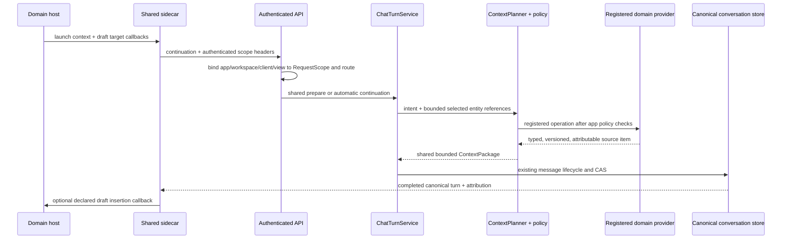

# Phase 25.4 architecture — application launch and sidecar contract

Date: 2026-10-11. This records the local integration contract. The four domain apps
remain reference fixtures; no live Travel, Shopping, Finance, or Health repository
adapter is composed here. External disclosure remains default-off at the runtime
gate. This phase does not close Phase 15 authorization/revocation or Phase 25.2
DynamoDB transaction acceptance.

## Composition and ownership

Phase 25.4 extends the existing Application Integration Contract and Phase 25.2/25.3
shared sidecar. It does not create a domain-side conversation store, provider
controller, context builder, or authorization model.

| Concern | Owner and seam |
| --- | --- |
| Launch identity | `ApplicationLaunchContext` is a versioned, bounded advisory value. Application/workspace/client context and route conversation must match the server-derived `RequestScope` and route. It carries no owner identity and grants no access. |
| Selected records | Entity references travel only inside launch context. They narrow `ContextPlanner`; the registered provider validates the exact app/workspace/entity under its own authoritative membership and read API. The reference itself never authorizes a fetch. |
| Context categories | A single `ContextSourceClass` contract is shared by provider planning, the builder, and sidecar policy. Domain declarations narrow the shared planner; returned data still passes field policy, sensitivity, provenance, expiry, permission revalidation, and builder budgets. |
| Orchestration | Automatic continuation remains `ChatTurnService.continue_turn`; manual and connected modes remain `ExternalTurnService` over the same chat preparation and completion path. No app or provider name selects an orchestration path. |
| Canonical state | Existing conversation/message repositories own the user prompt, prepared reservation, completed text, attribution, source identity, and replay state. Existing idempotency identity and CAS remain in force. No second sidecar or domain conversation is created. |
| Authorization | Verified principal and server-built `RequestScope` remain authoritative. Host metadata must match them; domain adapters own source membership checks and return current permission dependencies. Existing external authority rechecks those facts at external turn transitions, subject to the unresolved Phase 15 acceptance gates. |
| Post-completion | Manual import and connected completion use the existing `onExternalCompleted`/`onSaved` callbacks. Automatic continuation uses the existing chat/SSE callback. Original attribution is immutable when another mode continues a turn. |
| Host actions | The server-owned app policy declares Copy, context inclusion, draft target IDs, and future typed Apply IDs. Draft insertion requires both a host-declared target and an ID allowed by server policy. It is a host callback and does not call a domain write API. There is no Apply UI or Apply execution path in this phase. |

## Policy and data flow

`ApplicationSidecarPolicy` is an optional part of each registered application’s
existing `ApplicationContextPolicy`. It separately narrows connected-provider and
manual-external disclosure by allow/deny, allowed source categories, and maximum
sensitivity. The shared `ContextAssembler.plan_context` authorizes selected
operations and sensitivity before retrieval; the assembled effective sensitivity is
checked again before the reservation is bound. Application policy can only remove
sources from the registered plan.

Manual imported responses remain canonical Personal AI conversation turns with
`manual_external` and user-declared/unverified provenance. When an application sets
`allow_manual_import_context` false, the shared history projection omits both the
imported assistant turn and its paired user prompt before history authorization,
summary compatibility, or context building. Canonical messages and their original
attribution remain intact. External preparation still obeys Phase 25.3’s shared
external-context rules, including its existing memory exclusion.

Built-in Finance and Health manifests default to excluding manual imported turns
from later context. Their external execution modes remain empty. Personal AI allows
manual history reuse and declares its composer as a draft target. These are policy
facts consumed by shared code, not application-name conditionals.

`ApplicationLaunchContext` includes app, workspace, entity references, view,
conversation, and bounded client context. The frontend passes the same client
context through the existing request-scope header and launch value; the backend
requires equality. Launch data participates in the continuation intent digest. A
request without launch data retains the pre-25.4 digest shape so retries against
existing canonical turns remain stable.

## Preserved boundaries and later phases

- Provider adapters own source storage and current authorization; shared context
  owns selection, typed policy, assembly, provenance, sensitivity, and budgets.
- Domain records and validation stay with domain applications. Personal AI stores
  only conversation turns and existing shared execution metadata.
- Copy and manual import never invoke a domain mutation endpoint. Draft insertion
  writes only into a declared non-authoritative client surface. Phase 31 remains the
  only planned typed proposal/Apply boundary and must add domain validation and
  confirmation before any authoritative write.
- Connected provider credentials, account/model discovery, transport, and physical
  send continue through the Phase 25.1 user-local bridge and the Phase 25.2/25.3
  shared reservation path. Manual mode adds no provider authentication or browser
  automation.
- Phase 26–29 can supply their own registered typed providers, source revisions,
  context policies, and draft targets without changing generic orchestration.
  Phase 30 adds grants to the same source/permission chain. Phase 36 evaluates a
  synthetic fifth application against this same contract.

## Independent review focus

Challenge whether every launch field stays advisory and scope-bound; whether provider
membership and source-version checks happen before retrieval and are revalidated at
each required transition; whether summaries can reintroduce excluded manual history;
whether Copy/draft targets remain policy constrained; whether turn digests, retries,
and source attribution survive cross-mode continuation; and whether Finance/Health
can narrow policy without a generic-layer fork. Current local fakes prove the shape
of these contracts only. They do not establish live membership/revocation, immutable
policy/source history, DynamoDB CAS/race behavior, browser transport, provider
eligibility, or deployed identity.
