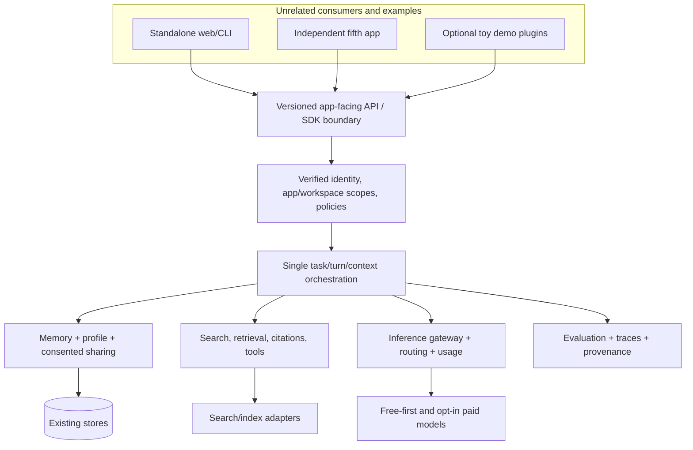

# Platform Independence — Architecture Charter and Phased Roadmap

**Project:** [`jasonkli21/personal-ai-system`](https://github.com/jasonkli21/personal-ai-system)  
**Location in repository:** `docs/platform-independence/platform-independence-roadmap.md`  
**Date:** 2026-10-30 (America/Los_Angeles)  
**Reference commit:** [`8571a8af33969f249614c2652a7d29c0c686f2d8`](https://github.com/jasonkli21/personal-ai-system/tree/8571a8af33969f249614c2652a7d29c0c686f2d8) (`main` at review)  
**Status:** proposed implementation charter; **not** a release approval or evidence that future-phase capabilities exist.  
**Authority:** repository code, executable contracts, migrations, and tests > verified review/evaluation evidence > accepted ADRs > architectural intentions > unimplemented plans. Security/privacy invariants always prevail. Refer to `AGENTS.md` and `docs/current-state.md` for current authoritative practice.

> **Product redefinition.** `personal-ai-system` is a useful, standalone, mostly-free AI **platform**, not a suite of Travel, Shopping, Health and Finance applications. Those four applications are optional **toys/reference consumers**. They must be uninstallable without removing the platform's value; a fifth unrelated application must integrate through stable, general-purpose contracts with no core code modification.

> **Explicit freeze.** Stop new *memory feature* development at **MEM-2**. MEM-0/1/2 implementation and the October 30 MEM-2 remediation are preserved as existing **default-off** work with unresolved review/production gates. Do **not** begin MEM-3, MEM-4, MEM-5, MEM-6, or MEM-7 as part of this roadmap. Correctness, security, portability and compatibility work in existing MEM-0/1/2 surfaces is allowed when necessary to make platform independence safe; do not expand memory product semantics under that label.

## 1. Executive decision

The repository already contains substantial reusable platform infrastructure, notably typed application definitions, application/context contribution catalogs, shared context assembly, an inference interface with LiteLLM adapters, source-grounded research, provider usage accounting, multi-scope memory, permission revalidation, provenance, durable task controls, and evaluation harnesses. **Keep those foundations.** Its *default composition and practical consumer experience* remain too closely aligned with the original apps and Gemini. Further MEM feature development would amplify complexity before platform independence is demonstrated.

Prioritize, in order: (1) **PI-0 reconciliation/guardrails**, (2) **PI-1 zero-toy-app core**, (3) **PI-2 unrelated external application**, (4) **PI-3 provider-neutral actual execution**, (5) **PI-4 consented shared personal context using existing MEM-0/1/2**, (6) **PI-5 general retrieval/tools**, (7) **PI-6 task-quality and cost optimization**, (8) **PI-7 operational packaging**, and (9) **PI-8 independent readiness audit**. Do not bundle multiple phases in one unreviewed implementation.

### Definition of success

A new developer can independently install or call the core platform, register an app (e.g., a developer notes or personal reading assistant unrelated to the four examples), authenticate a user, have scoped conversations, retrieve approved user-global preferences and app-local memories, search permitted sources, invoke a supported model under an explicit free-first policy, and receive usage/provenance/denial information **without editing platform business logic or importing toy apps**. Sensitive context never crosses app/provider boundaries merely because two apps share an owner ID.

### Non-goals

- Building or maintaining the toy apps as products, or implementing their domain workflows inside core.
- Training/hosting local models, maximizing number of model vendors, or implementing broad autonomous agents.
- Replacing the existing data stores, memory lifecycle, auth system, routing ledger, task engine or context assembler just for architectural neatness.
- Unifying every external product's identity/database, sharing full health/finance data by default, or making all memories globally visible.
- Treating free tier as guaranteed zero cost; usage and cloud resources can still incur charges.
- Calling MEM-2 production ready, promoting a model/evaluation variant, or resolving inherited Phase 36 gates without independent evidence.

## 2. Current state: code-grounded assessment

| Axis | Existing foundation | Independence gap | Conclusion |
| --- | --- | --- | --- |
| Application registration | `applications/contracts.py`, `registry.py`, entry-point `ApplicationContributionCatalog`, `create_app(...)` injection; a synthetic fifth app test exists | `default_application_registry()` still hardcodes four app manifests, their fields, tools and domains; app factory starts with that default | **Partially extensible; default remains suite-coupled** |
| Context sources | Typed provider factories, planning rules, permission revalidators, budgeted `ContextAssembler` | `context/deployment.py` imports Travel/Shopping/Finance/Health factories as fallback. Multiple domain-specific context modules live in the core package | **Good seams, insufficient packaging/composition boundary** |
| Domain/federation | Stable broker, grants, mutation and domain contracts | Initial federation cases and task metadata hardcode specific source/destination pairs and Shopping effects; domains registry constructs Travel/Shopping | **Examples dictate deployment metadata** |
| Model generation | `GenerationClient`, LiteLLM generation adapters for Gemini, Groq and Cloudflare Workers AI, routing/usage machinery | Normal `get_llm_client()` returns `GeminiLLMClient`; default context token counter, summarizer and memory adapter are Gemini-specific. Routed workflows remain separately gated | **Interfaces neutral; common composition is not** |
| Memory | Existing memory + schema-3 MEM-1 knowledge and default-off MEM-2 controls; provenance, scope, permission dependencies | Legacy retrieval is application/workspace scoped; app-to-app shared memory is not first-class and must not be simulated by removing scope checks | **Retain; add policy-mediated sharing later** |
| Search/retrieval | Search contracts, synthetic adapter, Brave snippet adapter, research evidence and evaluation | Registration remains small and research-centric; generic app-facing retrieval/tool API and provider cost portability are incomplete | **Extend contracts, not a second RAG system** |
| Identity & privacy | Verified principal, request scope, deny-by-default workspace membership, grants, source revalidation, deletion scaffolding | Mixed external app identity and deployments remain incompletely accepted; application manifests are not grants | **Design sharing around verified authorization** |
| Operations | Cloud Run/Neon/Postgres/pgvector/DynamoDB, endpoint and usage accounting, strict freeze/verification records | Full external cloud, identity, deletion, provider and Phase 36 acceptance remain open | **Free-first needs metered real-world demonstration** |

**Important nuance:** The synthetic fifth-app integration under `backend/tests/test_phase36_integrated.py` proves meaningful in-process extensibility, **not** an independently installed app, independent deployment, or production acceptance. The code's policies are intentionally restrictive; the problem is not that private memory is leaking by default. The product gap is safe, authorized sharing.

### Evidence anchors (pinned to the review commit)

- [`main.py`, `create_app()` and default router composition](https://github.com/jasonkli21/personal-ai-system/blob/8571a8af33969f249614c2652a7d29c0c686f2d8/backend/src/personal_ai/main.py#L84-L115)
- [`applications/registry.py`, default app and capability declarations](https://github.com/jasonkli21/personal-ai-system/blob/8571a8af33969f249614c2652a7d29c0c686f2d8/backend/src/personal_ai/applications/registry.py#L400-L460)
- [`context/deployment.py`, source-tree fallback registering four example factories](https://github.com/jasonkli21/personal-ai-system/blob/8571a8af33969f249614c2652a7d29c0c686f2d8/backend/src/personal_ai/context/deployment.py#L11-L54)
- [`domains/registry.py`, lazy but unconditional Travel/Shopping assembly](https://github.com/jasonkli21/personal-ai-system/blob/8571a8af33969f249614c2652a7d29c0c686f2d8/backend/src/personal_ai/domains/registry.py#L48-L64)
- [`federation/deployment.py`, four domain-pair cases](https://github.com/jasonkli21/personal-ai-system/blob/8571a8af33969f249614c2652a7d29c0c686f2d8/backend/src/personal_ai/federation/deployment.py#L14-L55)
- [`api/dependencies.py`, Gemini-bound common generation/context/memory composition](https://github.com/jasonkli21/personal-ai-system/blob/8571a8af33969f249614c2652a7d29c0c686f2d8/backend/src/personal_ai/api/dependencies.py#L180-L322)
- [`llm/providers.py`, existing generation adapter seam](https://github.com/jasonkli21/personal-ai-system/blob/8571a8af33969f249614c2652a7d29c0c686f2d8/backend/src/personal_ai/llm/providers.py)
- [`auth/scope.py`, app/workspace scope and denial contracts](https://github.com/jasonkli21/personal-ai-system/blob/8571a8af33969f249614c2652a7d29c0c686f2d8/backend/src/personal_ai/auth/scope.py#L15-L123)
- [`memory/services.py`, scoped legacy retrieval](https://github.com/jasonkli21/personal-ai-system/blob/8571a8af33969f249614c2652a7d29c0c686f2d8/backend/src/personal_ai/memory/services.py#L375-L433)
- [`context/authorization.py`, current denial of unauthorized cross-app selection](https://github.com/jasonkli21/personal-ai-system/blob/8571a8af33969f249614c2652a7d29c0c686f2d8/backend/src/personal_ai/context/authorization.py#L51-L105)
- [`test_phase36_integrated.py`, synthetic fifth app](https://github.com/jasonkli21/personal-ai-system/blob/8571a8af33969f249614c2652a7d29c0c686f2d8/backend/tests/test_phase36_integrated.py#L79-L180)
- [`docs/current-state.md`, MEM-0/1/2 and open evidence](https://github.com/jasonkli21/personal-ai-system/blob/8571a8af33969f249614c2652a7d29c0c686f2d8/docs/current-state.md)
- [`MEM-2 remediation record`, 2026-10-30](https://github.com/jasonkli21/personal-ai-system/blob/8571a8af33969f249614c2652a7d29c0c686f2d8/docs/memory/mem-2-review-remediation-2026-10-30.md)

## 3. Product boundaries and dependency rules

The **core product** consists of reusable service operations: authenticated request context; app/deployment registration; conversations and turns; safe context packing; memory/index and profile; explicit source discovery/retrieval; model execution and routing; tool/operation orchestration and approvals; evaluation/observability; retention/export/erasure; storage and deployability. A bundled web UI can provide an operator/reference consumer, but must not define a domain contract.

**Optional reference extensions** contain Travel/Shopping/Health/Finance manifest declarations, domain adapters, source-specific protocol clients, mappings, authorization wrappers, UI and fixtures. They may import a **published platform contract**, never the reverse. A standalone platform build must neither import nor install them. They should be independently enableable. In-repo files may temporarily remain in current directories for compatibility until extraction is validated; architectural ownership is the first milestone, physical moving the second.

**External providers/infrastructure** (Gemini, Groq, Cloudflare, Brave, auth issuer, pgvector, Neon, DynamoDB, GCP) are adapters or deployments, not core product concepts. No specific vendor's SDK, pricing, or context window should permeate generic service contracts. Provider identities, embedding space metadata, serialization versions and execution receipts remain explicit for auditability and migration.

### Mandatory import/composition direction

```text
Independent app / demo / optional domain plugin
     -> published API or SDK / platform extension contracts
     -> platform services + policy + orchestration
     -> ports (generation, embeddings, search, storage, identity)
     -> installed adapters (LiteLLM providers, Brave, PG/Dynamo, etc.)
```

Reverse imports from core into example apps are violations even when lazy and currently default-off. Distinguish **provider implementation** from **provider permission**. Application declaration is not consent or access authority. Neutral core must be usable with an empty optional extension catalog; unknown extensions and untrusted fields fail closed.

### Non-negotiable invariants

1. **Separation of concerns:** only one canonical chat turn lifecycle, context assembler, memory store/lifecycle, request-scope authority, inference accounting ledger, and durable task confirmation/reconciliation state machine. Reuse rather than fork.
2. **Identity:** derived canonical principal plus app/workspace/actor; no joins on email, raw UUID or `local` outside controlled test fixtures. Workspace authority always explicit and denial by default.
3. **Data flow:** source grant, user consent, sensitivity, exact source revision/permission dependency, destination app policy, provider disclosure policy and revalidation at use/send. No raw database cross-app access.
4. **Memory:** summaries ≠ persistent memories; evidence ≠ memory; no broad historical-scope override; no sensitive automatic sharing. MEM-2 flags remain default-off and its receipts/fences preserved.
5. **Operations:** typed intents; expected domain revision; explicit user confirmation for consequential writes; durable idempotency and observation-only recovery after uncertain external effects.
6. **Providers:** no remote call without prior authorization, current provider/data policy, budget/quota admission, cost estimate/limit and recorded attempt. Free-first is not vendor hardwiring.
7. **Failure semantics:** fail closed, explicit unavailable/partial status, no fabricated success on timeouts, revoke/forget invalidates downstream reuse as required.
8. **Evaluation:** fixtures and fakes prove local logic, not cloud IAM, actual provider behavior, blind utility, deletion, recovery or billing.
9. **Compatibility:** never silently repurpose existing IDs or persisted scopes; preserve migrations, verification receipts, historical locks and record formats.

## 4. Target architecture



### Public platform operations (design contracts, not existing endpoints)

| Surface | Target semantics and fields | Ownership |
| --- | --- | --- |
| Application registration | `application_id`, contract version, advertised capabilities, workspace rule, declared scopes and visibility | Server/registry; no client-supplied privilege escalation |
| Conversation/turn | app+workspace bound principal, idempotency/turn ID, streaming status, budget and provenance | Existing chat lifecycle |
| Context request | typed provider, operation, field projection, purpose, source references, token budget, known scope/consent | Existing planner and assembler |
| User-global memory read | server-derived owner, destination app, explicit permitted category/purpose, current consent/retention, source dependencies | Memory authority through existing stores and disclosure gate |
| Memory controls | bounded search/fetch/propose/review/reject/forget, verified actor and exact receipts; no default model-host registration | Existing MEM-2, unchanged until later reviewed portability work |
| Search/retrieve | query/source and rights envelope, bounded call and cost, canonical source/citation identity, freshness and partial-result status | Existing search/research with new interface adaptation |
| Inference | model capability requests, allowed providers, privacy policy, per-operation budget, structured attempt/outcome | Existing gateway/routing/usage infrastructure |
| Tool execution | registered versioned tool, typed args, permission scope, confirm/execute/reconcile identities | Existing mutation/task contracts |
| Diagnostics | redacted trace/cost/decision/denial, versioned evaluation receipts | Existing evaluation/observability |

Do not imply the full target API currently exists. A phase can define a v1 endpoint or in-process SDK, but an external consumer must not need private Python imports or bespoke knowledge of this project's internals. Prefer a **small, audited, versioned API** over promising a broad generic plugin SDK prematurely.

### Shared memory is a distinct *access policy*, not a flattened namespace

There are at least four separately governed classes: (a) user-global explicit preferences/profile with user-managed disclosure rules; (b) app/workspace-private conversational memories; (c) source-verified project/procedural knowledge; and (d) external, temporal evidence. A consumer's request for global context must be authorized through a server-controlled grant for the current user and destination. Initial sharing should support narrowly allowlisted **explicit user-profile fields**; richer derived memories must not be automatically promoted merely because the owner is the same. Memory write attribution, retraction, deletions, source expiration and data-use limitations must survive provider changes.

### Provider-neutral execution and free-first policy

Reuse `GenerationClient`, `EmbeddingClient`, token counting, existing LiteLLM/endpoint registry, usage accounting, routing and prepared-context semantics. Introduce a **composition/resolution contract** keyed by operation and capability rather than direct Gemini instantiation. Define deterministic selection policy: `allowed providers -> capability/privacy eligibility -> free/quota availability -> quality/cost preference -> bounded retries/fallback -> explicit unavailable`. Paid endpoints must require opt-in and a hard budget, not serve as silent fallback. Token count fallback can be estimated but must label uncertainty; never silently use Gemini to count a non-Gemini prompt. Embedder version/space migrations require compatibility or backfill plan, not ad hoc cross-vector comparisons.

## 5. Freeze boundaries and interaction with Memory program

### What MEM-2 means on 2026-10-30

`c0add2b` implemented **default-off** memory controls. `8571a8a` addressed identified review findings, including receipt quota interaction with forget, project revision retry drift, bounded expired-proposal purge, stale-source forget, partial lexical search and browser retry handling. Reports explicitly state **no full MEM-2 acceptance**, **no live host registration**, **no production issuance/lease**, and **no cloud/provider acceptance**. The known remaining risks include indefinite forget-receipt capacity/recovery, source-fence quota, physical deletion/backup restore, identity, actual provider sends, independent review, Phase 36 and utility/evaluation evidence. See `docs/current-state.md` and `docs/memory/mem-2-review-remediation-2026-10-30.md`.

| Class of work | During PI program | Conditions |
| --- | --- | --- |
| Preserve or regress-test MEM-0/1/2 | **Required** | No fixture/lock rewriting to conceal changes; keep flags disabled |
| Correct safety/replay/erasure defect in existing behavior | **Allowed, gated** | Narrow scope; independent review; no extension of memory taxonomy or autonomous policy |
| Generalize construction of existing memory embedder/generator | **Allowed in PI-3** | Same logical embedding space or explicit migration; keep MEM flags/semantics unchanged |
| Add consented cross-app global profile/memory views | **Allowed in PI-4** | A platform access feature, built on existing memory and policy, not MEM-3 capture/dreaming; optional and default-off |
| Implement MEM-3 episodic event capture / MEM-4 dreaming / MEM-5 retrieval research / MEM-6 ongoing promotion / MEM-7 autonomous reuse | **Frozen** | Separate explicit unfreeze and new independent architecture review after PI readiness |
| Promote MEM-2 host tools or memory into production | **Not authorized** | Close MEM-specific production gates separately |

**Freeze may not be bypassed by renaming a memory feature to a PI phase.** A change that alters memory admission/taxonomy, automatic extraction, consolidation, forgetting policy or host behavior must be flagged as outside PI scope and separately authorized.

## 6. Staged implementation plan

### Phase summary

| Phase | Goal | Indicative change envelope | Primary exit gate |
| --- | --- | --- | --- |
| **PI-0** | Review, reconcile, baseline and protect boundaries | Documentation + static inventory + targeted non-invasive checks | Evidence-anchored architecture, risk/decision ledger, reproducible baseline |
| **PI-1** | Core boots without any toy apps | Composition/packaging; narrow route/UI separation | Zero-example installation starts and functions |
| **PI-2** | Genuine external app integration | Versioned API + one independently packaged consumer | Fifth app requires no private imports or core patches |
| **PI-3** | Neutral generation/embeddings + free-first routing | Inference composition and provider policy | Non-Gemini and unavailable/fallback paths safely exercised |
| **PI-4** | Governed cross-app personal context | Existing profile/memory access policy + consent UI/API | Explicit global share works; private/sensitive denied |
| **PI-5** | General retrieval/search/tool capabilities | Adapter registry and generic data/rights contracts | Unrelated app can retrieve and cite through public API |
| **PI-6** | Evaluated harness optimization | Benchmarks, redacted traces, budget policies | Measured task utility / cost without privacy regressions |
| **PI-7** | Minimal, reproducible deployment | Local and cloud profiles, operator checks | Fresh environment boot, quota/cost/deletion drills evidenced |
| **PI-8** | Independent readiness assessment | Cross-cutting review/remediation | Explicit pass/fail and unresolved gates; no premature release |

### PI-0 — Independent architecture review, freeze and baseline (NOW)

**Entry:** pin review commit; inspect Git status and the latest `docs/current-state.md`; preserve user changes. Review core contracts, default app/runtime composition, auth, memory, inference, search, task and deployment paths. Record code-backed dependency edges and external acceptance gaps. Reconcile conflicts with past Chapter2 and MEM documents without rewriting their historical evidence.

**Deliverables:** (1) this roadmap and a browsable `docs/platform-independence/README.md`; (2) a PI-0 review/findings ledger; (3) a brief accepted/provisional architecture-decision ledger and proposed ownership matrix; (4) static, reproducible dependency inventory, plus narrow **non-invasive** regression guardrails that do not force PI-1 changes prematurely; (5) a reproducible offline check report with exact result/skip reasons; (6) living `docs/current-state.md`/`docs/README.md` updates clearly distinguishing plan from implementation. The Sol implementation handoff lives in `pi-0-sol-codex-handoff.md`.

**Scope limits:** no runtime refactor, memory schema/change of policy, provider/model dispatch, external app repo edits, migrations or deployment. Existing import edges are **waived and tracked**, not fixed by weakening auth/memory. If a baseline command can egress to a provider, isolate it or mark it blocked; the October 30 remediation expressly reported an offline suite attempt that reached Google.

**Exit:** every claim has path/symbol + evidence status; code coupling is categorized rather than hand-waved; downstream phases have clear contracts/gates; freeze is recorded; relevant narrow tests run or transparently not run. Independent PI-0 review of the resulting artifacts precedes PI-1.

### PI-1 — Empty-core and optional reference extensions

**Problem:** `default_application_registry()`, default context runtime catalog, default federation/task cases, domain registry, app routes and UI assume examples. **Work:** split registered built-in platform app (`personal_ai`) and capabilities from optional app packages; replace implicit fallbacks with deterministic explicit installation; move existing example manifests/adapters/federation mappings out of default assembly; make task/federation metadata generic and absence-safe; keep compatibility route plugins only where explicitly installed; document feature flags per extension. Use existing `ApplicationContributionCatalog` and `ContextRuntimeContributionCatalog` rather than another plugin engine. Introduce an empty-catalog integration test that imports/starts production app factory with no demo modules available (use isolated installed distribution or import-deny harness; not merely feature-off). Handle cold starts, lifespan, absent historical reconciler bindings and unsupported routes safely.

**Acceptance:** core starts; standalone chat/context/official profile and permitted memory/search operations work through local fakes, empty optional manifests; no import of example modules; missing domain routes return controlled unavailable/404; legacy opt-in example compatibility tests pass when installed; no changes to persisted IDs or memory permissions. No production data. **Rollback:** restore prior explicit catalog composition, retain new neutral contracts and data.

### PI-2 — Versioned unrelated app consumer

**Problem:** synthetic fifth-app tests are in-process and use private types. **Work:** publish a deliberately narrow external API/SDK contract (open version, auth, idempotency, app/workspace scope, request/response/error/stream status), registration/permission lifecycle and minimal provider/tool/context declaration story; independently package a **notes/reading/logbook** sample that uses only documented public API and its own records. Support a smoke CLI and optional thin HTTP integration; avoid cross-app memory until PI-4. Provide supported upgrade/deprecation policy and secrets handling.

**Acceptance:** fresh clone/install of consumer with no `personal_ai` source imports; end-to-end create conversation, fetch scoped context, stream response through fake/test backend, handle denied workspace, retry same key, reject forged owner/app/actor; verify uninstall does not break platform. **Rollback:** disable consumer and new endpoint behind compatibility flag; existing API persists.

### PI-3 — Capability-driven provider independence and cost policy

**Problem:** runtime generation, summaries, counting and embeddings default to Gemini despite neutral infrastructure. **Work:** define a single operation-level provider policy and builder; compose chat, summaries and memory through accepted provider-neutral ports; preserve model identity, count semantics and persisted embedding-space provenance; choose from installed adapters (not a baked-in provider whitelist where registries suffice), keep egress gating and provider usage accounting; distinguish offline fake, strict-free, mostly-free-paid-opt-in and explicit paid profiles; fail safe on quota/429/outage, no unsupported silent fallback. Avoid enabling adaptive routing shadow models without their own acceptance.

**Acceptance:** equivalent offline generation with two distinct adapters, one real conditional provider integration if safely authorized, no credential requirement for unavailable adapter, budget checks before dispatch, per-operation usage attribution, correct no-paid fallback, no dual-send on uncertain outcome, MEM-0/1/2 regressions and existing embedding space compatibility. **Rollback:** configured legacy Gemini adapter behind same interface, not a second chat loop.

### PI-4 — User-governed cross-app memory and personal context

**Problem:** automatic memory is scoped to current app/workspace; desirable user-global context needs explicit policy. **Work:** start with explicit user-managed global profile fields and shared *views* of existing verified memory, not raw wholesale namespace merges. Define sensitivity class, source app, permitted destination(s), purpose, field/record scope, expiration/revocation, grant revision, actor and disclosure policy; extend access via existing context provider/authorization/revalidation and memory lifecycle. Use the current signed/federated identity mechanisms where compatible, not a fresh shadow principal map. Add provenance/deletion cascades and negative tests. Maintain MEM-2 default-off and do not launch agents/episodic capture/dreaming. Mark irreversible disclosure explicitly and give users precise controls.

**Acceptance:** an allowed preference is observed in app B after explicit user action; same owner's app-private record is **never** observed without grant; sensitive health/finance and expired/revoked data denied; provider-send revalidation, conflicting source version, deleted source, actor mismatch, grant expiry, prior summaries and cache invalidation verified. Existing per-app retrieval tests unchanged. **Rollback:** disable global sharing; retain revocation/erasure fences and data.

### PI-5 — App-neutral search, retrieval and tools

**Problem:** research and search are provider/feature-specific; example tools risk redefining core. **Work:** widen existing search adapter registry, rights/source policy and canonical evidence format to versioned app-facing retrieval; support at least one local index/offline corpus and a separately configured external search source. Build minimal read-only tool registration from existing extension contracts; leave durable domain mutations behind existing explicit confirmation/reconciliation. Ensure source privacy, allowed-domain filters, quote/snippet rights, freshness and result budgets; no background scraping or unmanaged credential sharing.

**Acceptance:** new consumer retrieves both local and external eligible sources through public API with citations and source timestamps; revoked material filtered at final context construction; unavailable tools/search return partial/unavailable; token/cost deadlines enforced. **Rollback:** disable new registry adapters, preserve stored evidence and references.

### PI-6 — Optimization with a falsifiable harness benchmark

**Work:** freeze versioned end-to-end tasks spanning single-app, app-switch, memory correction, research citation, provider failure, long-context, repeat idempotent write and privacy adversaries. Compare fixed baseline, no-memory, selective memory, retrieval strategies and provider routing at matched budgets with blinded/held-out cases where possible. Include tail latency, provider success, total actual paid spend, free tier pressure, token packing, quality/grounding, unauthorized disclosure, stale/expired use, no-op and duplication. Avoid optimizing only structural synthetic pass rates or calling a fake evidence of model utility.

**Acceptance:** every optimization has task-level lift/cost regression report, source/runtime/fixture/model identities and error bars; the negative privacy suite never regresses; disabled alternatives stay disabled if value not demonstrated. **Rollback:** deterministic fixed policy.

### PI-7 — Local-first and free-first operations

**Work:** document one-command local development with fake/offline model and minimal persistence; version/install optional model/search/data adapters; reproducible cloud profile with a hard quota and request/identity egress policy; explicit cost ceilings, secret storage, per-app isolation, deploy/reset/restore docs. Audit whether existing PG/Dynamo split is *operationally justified* before changing stores; avoid gratuitous new architecture. Test cost-free mode without external credentials; run opt-in hosted smoke with documented billing caps only when approved. Audit account deletion, retained replay receipts, backups, source erasure and restore fences.

**Acceptance:** clean minimal install and independent sample; no example env settings required; no paid call under strict-free profile; real cost/source attribution; measured start/cold-path/usage; native store and deletion/recovery evidence where actually available. **Rollback:** disable cloud/paid profile; retain durable deletion and replay artifacts.

### PI-8 — Independent platform readiness audit

**Work:** skeptical inspection of source, contracts, packaging and live evidence, with threat model and gap finding not biased to this roadmap. Attempt: remove all example source packages, install unrelated app, replace model and search, switch/withdraw memory grants, break provider network, exhaust quota, replay uncertain tasks, delete user, recover a stale backup and read from another actor. Classify P0/P1/P2, require separate remediation and re-verification. Close only proven gates and leave cloud/paid/live model functionality explicitly gated if not tested.

**Acceptance:** independent review with no unexplained P0s, evidence-backed usability and authorized multi-app continuity, and an operator-grade accurate release status. No marketing claim of general production readiness from hermetic tests.

## 7. Acceptance matrix (minimum)

| # | Acceptance case | Primary phase |
| --- | --- | --- |
| A01 | Core starts in environment with no example modules installed | PI-1 |
| A02 | `personal_ai` standalone still supports conversation/context | PI-1 |
| A03 | Sample app integration does not require core source edits | PI-2 |
| A04 | Sample requires no private Python imports and runs via versioned API | PI-2 |
| A05 | Unregistered app / nonexistent workspace denied by default | PI-1/2 |
| A06 | Forged owner, actor, app header or service token denied | PI-2 |
| A07 | Duplicate idempotency request cannot duplicate effect | PI-2/5 |
| A08 | Non-Gemini generation handles streaming, timeout, accounting | PI-3 |
| A09 | A provider lacking count/embed cannot silently use Gemini | PI-3 |
| A10 | Strict-free policy never triggers paid model/search fallback | PI-3/7 |
| A11 | 429/outage/quota produces accurate unavailable status | PI-3 |
| A12 | Existing embedding vector space is not silently mixed/migrated | PI-3 |
| A13 | Explicitly shared user-global preference works across apps | PI-4 |
| A14 | Same owner's app-private memory remains unavailable | PI-4 |
| A15 | Revocation, expiry, deletion and stale source stop re-use/send | PI-4 |
| A16 | Health/Finance restricted information denied absent specific grant | PI-4 |
| A17 | Local and remote evidence preserve citation, rights, freshness | PI-5 |
| A18 | Unauthorized tool or stale reference cannot escalate | PI-5 |
| A19 | Held-out task utility improves without safety or cost regressions | PI-6 |
| A20 | Restore/retained receipts do not resurrect revoked/forgotten data | PI-7/8 |
| A21 | Fresh install works with no external credentials | PI-7 |
| A22 | Reviewer can reproduce claims and independently find defects | PI-8 |

These are intended as **acceptance tests**; they are not claimed results. Add tests for observed defects even if they are not enumerated here.

## 8. Cross-cutting execution discipline

Each phase is a separate reviewed change with: pinned base and `git status`; scope/non-goals; ownership and threat/abuse paths; plan + tests before code; artifact/report; offline unit/integration/negative tests; native or cloud evidence when relevant; diff/contract/compatibility review; rollback; independent adversarial review; and no promotion without acceptance. A Sol Medium implementation session should handle bounded, pre-specified work; use Sol High for phase architecture, ownership changes, hard state/security transitions, or independent review. Do not spawn subagents unless expressly authorized; preserve all unrelated user changes.

**Migration rules:** retain data schema compatibility; add explicit versioning to new APIs; never hide known gates by deleting tests, altering strict evaluation locks or rewriting historical reports. Route/domain deprecation should have a transition profile and migration playbook. Introduce new client-visible behavior default-off until its own tests are accepted.

**Documentation organization:** all PI-specific charter, baseline, ADRs, plans, prompts, findings and phase evidence live at `docs/platform-independence/`. Other canonical owners (`docs/current-state.md`, `docs/memory/`, package READMEs, `stabilization/`) remain in place and should be linked, not copied or silently superseded. Maintain one PI index; name later plans `pi-1-...`, etc. When statuses diverge, code and `docs/current-state.md` control.

## 9. Risk register and unresolved architecture decisions

| Risk / decision | Default direction | When to close |
| --- | --- | --- |
| Whether to physically extract examples into packages or another repo | Prove empty-core first; choose packaging after import graph and compatibility assessment | PI-1 |
| Whether to expose REST, SDK, or both | Version small API first; thin SDK optional; external app must never need internals | PI-2 |
| How external app identity maps to canonical owner | Reuse verified issuer/subject and explicit mappings; no new global-user DB without evidence | PI-2 |
| Whether provider selection is model-, operation-, or deployment-driven | Capability/policy/operation-driven; explicit allowlist and spending cap | PI-3 |
| How to share verified memory across apps | Consent-governed views with exact provenance, not namespace flattening | PI-4 |
| How to handle retention and derived context after revocation | Current revalidator plus invalidation/retained fences; destructive delete must not erase replay proof | PI-4/7 |
| Whether to replace Brave/add vector search | Prove need with free-first eval; adapters behind same contracts | PI-5/6 |
| How much real evaluation is affordable | Small reproducible fixture set plus explicitly opt-in capped real-model tests | PI-6 |
| Long-lived replay receipts and source fences from MEM-1/2 | Preserve; design bounded capacity/recovery/erasure with independent safety review | Blocking separate MEM production acceptance; PI-7 assesses |
| Whether to change PG/Dynamo/cloud provider | Do not conflate platform independence with storage rewrite; measure cost and correctness | PI-7 |

## 10. Exit criteria for the overall program

The platform can operate **without examples**, and one separately installed app can use the versioned core through a documented, verified boundary. It has a functioning provider-neutral free-first path, no silent paid fallback, deliberate owner-scoped cross-app preference sharing, typed search/retrieval, attributable outputs, and clear user revocation/erasure semantics. Security, performance and task value are evidenced rather than inferred. **MEM-3+ remains frozen** pending a new explicit decision, regardless of PI readiness. Any unverified production/cloud/identity/deletion/provider gate must be prominently retained in the readiness report.

**Historical pre-implementation next action (superseded):** use the self-contained `pi-0-sol-codex-handoff.md` to execute only PI-0; compare the resulting report against the independent `pi-0-review.md`; then commission a fresh independent check before PI-1.

**Current next action:** complete independent PI-0 remediation/reverification and obtain independent acceptance. Only then prepare PI-1 planning for explicit review; PI-1 implementation requires its own approval and entry gates. MEM-3+ remains frozen.


## 2026-10-30 PI-0 implementation reconciliation

The supplied nine-phase roadmap and A01–A22 contract are preserved. The local
PI-0 baseline is now documented in the [report](pi-0-implementation-report.md),
[decisions](pi-0-architecture-decisions.md), [inventory](pi-0-dependency-inventory.md)
and [exit contract](pi-0-exit-contract.md); this is not independent acceptance.
PI-1..8 remain future work. Source is the same exact review commit `8571a8af33969f249614c2652a7d29c0c686f2d8`.

Two precision corrections guide later plans: installed wheel entry points already
register all four context factories in addition to the source-tree fallback, and
`context/profile.py` already supports `preferred_units`, `locale`, `response_style`
and `answer_length` with explicit destination shares. PI-4 should validate/reuse
that view, then address remaining governed memory-access gaps; it must not invent
a second profile store or remove app/actor/source checks. These findings do not
change memory storage, taxonomy, extraction or the MEM-2 freeze.

For every PI-1..8 entry, the preceding phase's independent exit is an entry gate;
changes to identity, source policy and replay require their owning contracts and
relevant inherited acceptance first. PI-0 rollback removes diagnostics and new
routing/status notes only. PI-8 audit rollback withholds readiness, returns to the
last accepted profile and retains deletion/replay evidence; it never reinterprets
old records. No roadmap phase is itself permission for paid/provider/cloud action.

## 2026-10-30 PI-4 candidate reconciliation

The user separately authorized PI-4 despite pending earlier independent acceptance.
The [implementation report](pi-4-implementation-report.md) records the bounded
profile-consent candidate and [verification matrix](pi-4-verification.json).
This does not rewrite the roadmap's entry/exit gates: PI-0–4 independent acceptance
is still pending. Exact-record memory sharing is explicitly unavailable without
original source issuer/lease authority; browser consent UX remains incomplete.
MEM-3+ stays frozen. PI-5–8 and production readiness remain undelivered.
